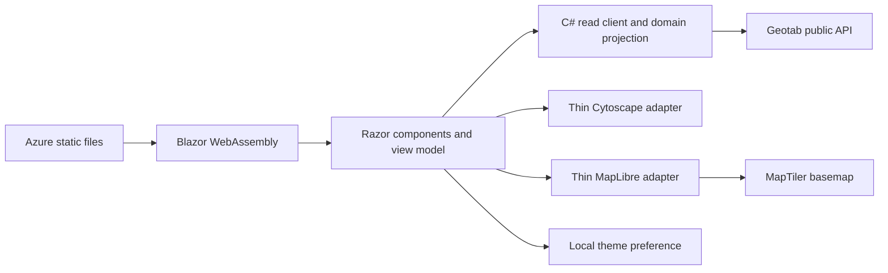

# Linked Assets: end-to-end design and implementation status

Created: 2026-11-21. Governing document: [constitution v1.2.0](../.specify/memory/constitution.md). Status: local application implementation verified; live Geotab and deployment gates remain open. Official documentation was consulted on 2026-11-21; tenant behavior still requires the live checks below.

**For every implementation agent:** read this design and the [implementation checklist](#implementation-checklist) before starting. The checklist is the **single source of truth for implementation status**. Reference its stable task IDs in your work and update it as work starts, finishes, becomes blocked, or is handed off. A design decision, generated file, successful compilation, or verbal progress report alone does not establish completion. The constitution remains the authority for requirements.

## Design

### 1. Scope and confirmed decisions

Build one standalone Blazor WebAssembly application that reads Geotab data directly from the browser. Users sign in, explore independent linked-asset graphs, filter and arrange them, and inspect the selected link's member positions and report times in a right-hand overlay.

The owner confirmed these decisions during planning:

| Decision | Result |
| --- | --- |
| Time scope | Display active links and currently active members only. Historical data may be read to establish addition recency, but there is no historical browsing UI. |
| Authentication | Standalone Geotab sign-in; no MyGeotab Add-In integration. |
| Scale | Hundreds of visible links. Use 500 visible links, 2,000 rendered device nodes and approximately 6,000 segments as the initial performance fixture. The exact stress fixture has 214 eight-member links, one three-member link and 285 single-member links: 2,000 visual nodes and 5,995 unordered-pair segments, including shared device identities. Uniform four-member links would have only 3,000 segments. These are verification targets, not silent display limits. |
| Cold Chain classification | Every `AssetLink` whose `linkType` is `AssociatedDevice` is displayed as Cold Chain. This is the owner's product mapping, not a claim that the API enum itself means only cold chain. |
| Test access | Development is on a personal laptop without employee credentials for the internal `g560` database. Make public demo access and independent local tests the development path. |

Deployment-trial provider decision (2026-11-22, LA-043): owner selected OpenFreeMap Liberty/Dark, as used in the local preview. This replaces the MapTiler/key prerequisite for this trial, while retaining MapLibre rendering, both themes and provider attribution.

Design defaults: English UI; ordinal case-insensitive name search; light theme initially; theme preference persisted locally; browser reload for a fresh snapshot; MapTiler light/dark styles following Transit Jazz; no automatic polling, playback, editing, export, collaboration, backend, or persistent domain-data cache. The owner did not choose a map subscription or provision credentials. Use a separate browser key and configured style URLs at implementation/deployment time.

### 2. Requirements and traceability

| ID | Required outcome | Design sections | Acceptance checks |
| --- | --- | --- | --- |
| R01 | Browser-only C#, read-only Geotab domain data | 3–6, 13 | V01, V02 |
| R02 | Transit Jazz architecture, components, theme, utilities | 3, 4, 9 | V03, V15 |
| R03 | AssetLink automatic/associated and DeviceLink manual sources | 5–7 | V04, V05 |
| R04 | Independent graph per source record; shared devices duplicated visually | 5, 7, 8 | V05, V06 |
| R05 | Device name on every node; type color on nodes and segments | 7–9 | V06, V15 |
| R06 | Fluid pan/zoom, whole-link movement, individual-node movement | 8 | V07, V17 |
| R07 | Selection opens/updates right overlay without resizing canvas | 9, 10 | V08, V09 |
| R08 | Still map fits every available latest position; explicit missing data | 10 | V10, V11 |
| R09 | Bulleted per-member latest report times | 6, 10 | V11, V12 |
| R10 | Empty search unrestricted; substring match retains whole link | 7 | V13 |
| R11 | Type toggles default on, strike through when off, combine with search | 7, 9 | V13 |
| R12 | Most Recent uses addition evidence; deterministic Link Type sort | 7, 8 | V14 |
| R13 | Exactly one deployment workflow, one Azure Static Web App, Bicep | 13 | V18, V19 |
| R14 | Minimal scope; meaningful automated and real-browser verification | 3, 11, 12 | V01–V20 |

### 3. Transit Jazz inspection and reuse decisions

Reference root: `C:/Projects/ChefKnifeStudios.TransitJazz`. Inspected working-tree files on 2026-11-21; repository HEAD was `d71fe8af45d9922289b4c2561f9a3a9411535ad7`. Working-tree contents, rather than a claim about an immutable release, informed these decisions. Reinspect the relevant file before copying it if that repository changes.

| Inspected references | Copy/adapt into Linked Assets | Deliberate limit or correction |
| --- | --- | --- |
| [WebApp project](../../ChefKnifeStudios.TransitJazz/src/Client/ChefKnifeStudios.TransitJazz.Client.WebApp/ChefKnifeStudios.TransitJazz.Client.WebApp.csproj), [Shared project](../../ChefKnifeStudios.TransitJazz/src/Client/ChefKnifeStudios.TransitJazz.Client.Shared/ChefKnifeStudios.TransitJazz.Client.Shared.csproj), [Core project](../../ChefKnifeStudios.TransitJazz/src/Client/ChefKnifeStudios.TransitJazz.Client.Core/ChefKnifeStudios.TransitJazz.Client.Core.csproj), [Program.cs](../../ChefKnifeStudios.TransitJazz/src/Client/ChefKnifeStudios.TransitJazz.Client.WebApp/Program.cs) | .NET 10 browser host → Razor UI library → client service/model library; DI composition in WebApp | Remove SignalR, server/shared-transit references, charts, audio, localization infrastructure without a current requirement, and transit endpoints. |
| [BaseViewModel](../../ChefKnifeStudios.TransitJazz/src/Client/ChefKnifeStudios.TransitJazz.Client.Shared/BaseViewModel.cs), [RouteFilterViewModel](../../ChefKnifeStudios.TransitJazz/src/Client/ChefKnifeStudios.TransitJazz.Client.Shared/ViewModels/RouteFilterViewModel.cs) | ObservableObject base and generated observable properties; UI subscribes/unsubscribes to property changes | One page view model initially; no transit route selection or vehicle counting. |
| [EventNotificationService](../../ChefKnifeStudios.TransitJazz/src/Client/ChefKnifeStudios.TransitJazz.Client.Core/Services/EventNotificationService.cs) | Typed theme notifications | Use direct view-model commands for page actions; do not introduce another event bus. |
| [HttpService](../../ChefKnifeStudios.TransitJazz/src/Client/ChefKnifeStudios.TransitJazz.Client.Core/Services/HttpService.cs), [HttpServiceFactory](../../ChefKnifeStudios.TransitJazz/src/Client/ChefKnifeStudios.TransitJazz.Client.Core/Services/HttpServiceFactory.cs) | HttpClient creation, cancellation, safe failure/result handling, logging conventions | Geotab uses JSON-RPC over POST even for reads. Parse the RPC error envelope on HTTP 200. Omit mutation helpers and transit serialization converters. A general multi-API factory is unnecessary for one Geotab transport. |
| [ViewportSizeJsInterop](../../ChefKnifeStudios.TransitJazz/src/Client/ChefKnifeStudios.TransitJazz.Client.Shared/Services/JsInterop/ViewportSizeJsInterop.cs), [interface](../../ChefKnifeStudios.TransitJazz/src/Client/ChefKnifeStudios.TransitJazz.Client.Shared/Services/JsInterop/IViewportSizeJsInterop.cs), [JS module](../../ChefKnifeStudios.TransitJazz/src/Client/ChefKnifeStudios.TransitJazz.Client.Shared/wwwroot/js/viewportSizeJsInterop.js) | Lazy imports, typed callbacks, idempotent subscriptions, resize debounce and disposal | Prefer element ResizeObserver for canvas/map dimensions; do not send per-frame pointer events to .NET. |
| [OutsideClickJsInterop](../../ChefKnifeStudios.TransitJazz/src/Client/ChefKnifeStudios.TransitJazz.Client.Shared/Services/JsInterop/OutsideClickJsInterop.cs) | Listener registration/removal pattern if needed | Track and dispose every DotNetObjectReference. Do not copy reference leaks or blanket close-on-any-outside-click behavior. |
| [app.css](../../ChefKnifeStudios.TransitJazz/src/Client/ChefKnifeStudios.TransitJazz.Client.WebApp/wwwroot/css/app.css), [variables.css](../../ChefKnifeStudios.TransitJazz/src/Client/ChefKnifeStudios.TransitJazz.Client.WebApp/wwwroot/css/variables.css), [mdc-overrides.css](../../ChefKnifeStudios.TransitJazz/src/Client/ChefKnifeStudios.TransitJazz.Client.WebApp/wwwroot/css/mdc-overrides.css), [index.html](../../ChefKnifeStudios.TransitJazz/src/Client/ChefKnifeStudios.TransitJazz.Client.WebApp/wwwroot/index.html) | Roboto, base CSS tokens, relevant Material overrides, asset loading and initial-theme bootstrap | Omit analytics, transit FAB positioning, synth scripts and unrelated toast styles. Vendor required scripts/fonts with licenses. |
| [ColorConstants](../../ChefKnifeStudios.TransitJazz/src/Client/ChefKnifeStudios.TransitJazz.Client.Shared/Constants/ColorConstants.cs), [MainLayout](../../ChefKnifeStudios.TransitJazz/src/Client/ChefKnifeStudios.TransitJazz.Client.WebApp/Layout/MainLayout.razor) | Active Light/Dark palettes, MatThemeProvider and `.mj-dark` | Ignore LightNotUsed/DarkNotUsed. Keep canvas, blade, map and controls synchronized. |
| [DarkModeFab](../../ChefKnifeStudios.TransitJazz/src/Client/ChefKnifeStudios.TransitJazz.Client.Shared/Components/FABs/DarkModeFab.razor), [SettingsService](../../ChefKnifeStudios.TransitJazz/src/Client/ChefKnifeStudios.TransitJazz.Client.Shared/Services/SettingsService.cs), [Settings](../../ChefKnifeStudios.TransitJazz/src/Client/ChefKnifeStudios.TransitJazz.Client.Shared/Models/Settings.cs), [SettingsChangeController](../../ChefKnifeStudios.TransitJazz/src/Client/ChefKnifeStudios.TransitJazz.Client.Shared/Services/SettingsChangeController.cs), [ThemeChangedEventArgs](../../ChefKnifeStudios.TransitJazz/src/Client/ChefKnifeStudios.TransitJazz.Client.Shared/EventArgs/ThemeChangedEventArgs.cs) | Theme preference, in-memory fallback when storage fails, typed notification and async result sequencing | Reduce to a typed theme operation; omit reflection-based settings editor, audio compensation and generic settings transaction machinery. |
| [BladeContainer markup](../../ChefKnifeStudios.TransitJazz/src/Client/ChefKnifeStudios.TransitJazz.Client.Shared/Components/Blades/BladeContainer.razor), [code](../../ChefKnifeStudios.TransitJazz/src/Client/ChefKnifeStudios.TransitJazz.Client.Shared/Components/Blades/BladeContainer.razor.cs), [CSS](../../ChefKnifeStudios.TransitJazz/src/Client/ChefKnifeStudios.TransitJazz.Client.Shared/Components/Blades/BladeContainer.razor.css), [SettingsBlade](../../ChefKnifeStudios.TransitJazz/src/Client/ChefKnifeStudios.TransitJazz.Client.Shared/Components/Blades/SettingsBlade.razor) | RenderFragment composition, fixed right edge, full-height overlay and short slide transition | Link selection updates the existing blade. Explicit close/Escape; no 300 ms close suppression. Canvas keeps its dimensions. |
| [RouteFilterList markup](../../ChefKnifeStudios.TransitJazz/src/Client/ChefKnifeStudios.TransitJazz.Client.Shared/Components/RouteFilterList.razor), [CSS](../../ChefKnifeStudios.TransitJazz/src/Client/ChefKnifeStudios.TransitJazz.Client.Shared/Components/RouteFilterList.razor.css) | Small theme-aware components, callbacks, `aria-pressed`, focus treatment | Render three key labels with strike-through, not route pills or category selection. |
| [Map markup](../../ChefKnifeStudios.TransitJazz/src/Client/ChefKnifeStudios.TransitJazz.Client.Shared/Components/Map.razor), [code](../../ChefKnifeStudios.TransitJazz/src/Client/ChefKnifeStudios.TransitJazz.Client.Shared/Components/Map.razor.cs), [helper](../../ChefKnifeStudios.TransitJazz/src/Client/ChefKnifeStudios.TransitJazz.Client.Shared/Components/Map.razor.Helper.cs), [map-interop.js](../../ChefKnifeStudios.TransitJazz/src/Client/ChefKnifeStudios.TransitJazz.Client.Shared/wwwroot/js/map-interop.js) | MapLibre lifecycle, GeoJSON, theme style changes, bounds calculation, cleanup | Remove the first-source early return, 20-point cap, minimum zoom 7, live tracking and animations. Fit all selected positions on initial render. |
| [client.yml](../../ChefKnifeStudios.TransitJazz/.github/workflows/client.yml), [staticWebApp.bicep](../../ChefKnifeStudios.TransitJazz/bicep/modules/staticWebApp.bicep), [main.bicep](../../ChefKnifeStudios.TransitJazz/bicep/main.bicep) | Release publish/artifact/deploy sequence; staticSites module and outputs | Use Linked Assets names, `globalHeaders`, empty API location; omit synth stamping, DNS, Key Vault and extra workflows. Disable automatic workflow generation. |

Filter/grid reference inspection (2026-11-22, LA-022/LA-023): re-read Transit Jazz `RouteFilterViewModel.cs` and `RouteFilterList.razor`. Retain the existing observable C# filter state, Razor callbacks and thin Cytoscape bridge; grid geometry stays with the renderer and does not introduce another UI or architecture pattern.

Agent UI seam reference inspection (2026-11-22, LA-049): re-read Transit Jazz `Program.cs`, `FeatureFlagService.cs` and `SettingsService.cs`. Keep optional verification UI in the Shared Razor layer using one `AgentOnly` RenderFragment wrapper. A single explicit URL opt-in needs no flag dictionary, persistent settings, new DI service or JS interop.

The [default mockup](linked-assets-default-mockup.png), [blade mockup](linked-assets-details-blade-mockup.png) and [broader reference](linked-assets-mockup.png) were visually inspected. They determine location and silhouette; Transit Jazz determines styling.

### 4. Technology and application boundaries

| Choice | Baseline and rationale | Tradeoff |
| --- | --- | --- |
| Standalone Blazor WebAssembly | `net10.0`, matching Transit Jazz; no server project or SSR. Static files execute in the browser. [Microsoft overview](https://learn.microsoft.com/en-us/aspnet/core/blazor/?view=aspnetcore-10.0) | Browser downloads the runtime; external requests must satisfy CORS. |
| MatBlazor | 2.10.0, as inspected; MatThemeProvider, buttons, text input, icon buttons. [Theme API](https://www.matblazor.com/Themes) | Older package baseline; verify its actual .NET 10/browser behavior in the shell spike. It is constitutionally required. |
| CommunityToolkit.Mvvm | 8.4.0, matching reference; observable page state. [ObservableObject](https://learn.microsoft.com/en-us/dotnet/communitytoolkit/mvvm/observableobject) | Keep component subscriptions explicit and dispose them. |
| Blazored.LocalStorage | 4.5.0, matching reference; theme preference only. [Library documentation](https://github.com/Blazored/LocalStorage) | Credentials use a small sessionStorage bridge, not this persistent preference store. |
| Ardalis.Result | 10.1.0 observed in reference; adapt result conventions only where transport needs them | Avoid a second general result framework. |
| Cytoscape.js | Pinned 3.35.0; graph rendering, labels, node dragging, compound groups, pan/zoom and supplied positions. [API](https://js.cytoscape.org/), [release](https://github.com/cytoscape/cytoscape.js/releases/tag/v3.35.0) | New, narrow JS adapter needed; canvas accessibility needs an HTML equivalent. Whole-link edge dragging must be proven in the spike. |
| MapLibre GL JS | Start with 4.7.1 to stay in Transit Jazz's 4.x line; lock exact JS/CSS together. [Release](https://github.com/maplibre/maplibre-gl-js/releases/tag/v4.7.1), [Map API](https://maplibre.org/maplibre-gl-js/docs/API/classes/Map/) | Current online examples may target newer majors. Verify each used API against the installed version; upgrade only for a concrete incompatibility. |
| MapTiler | Configured light/dark styles, following reference configuration | Requires usable styles and a browser key. Restrict the new key to localhost/production origins; it is public client configuration. [Key documentation](https://docs.maptiler.com/guides/developer/credentials/api-key/) |

The .NET package version `10.0.9` is an inspected reference baseline, not a claim that it is the latest servicing version. During bootstrap, pin one compatible .NET 10 SDK and aligned Microsoft package patch versions, record resolved versions, and check published Release output. Pin JS assets and licenses under `wwwroot/vendor`; avoid runtime `latest` URLs. No Node application framework is required. Implementation pins SDK 10.0.401, Microsoft packages 10.0.15 and Playwright 1.58.2. Typed safe transport failures make the Ardalis.Result dependency unnecessary; it was not imported solely to match the reference.

Alternatives considered: [Blazor.Diagrams](https://github.com/Blazor-Diagrams/Blazor.Diagrams) supports groups and pan/zoom with predominantly C# code and is a viable fallback if the graph spike fails. Cytoscape is selected for the small-dot network rendering and browser-side gesture loop. [tldraw](https://tldraw.dev/installation) requires React integration; its interaction quality is the benchmark, but adding another UI framework is unnecessary. Handwritten SVG would require more custom gesture/hit-testing work. Do not ship multiple graph engines.

Proposed structure (files below are implementation targets, not existing artifacts):

```text
ChefKnifeStudios.LinkedAssets.slnx
global.json
src/Client/
  ChefKnifeStudios.LinkedAssets.Client.Core/
    Models/                  # source DTOs, immutable normalized records, outcomes
    Services/                # GeotabSessionService, GeotabReadClient, LinkedAssetsService
    Graph/                   # normalization, filter, sort, initial arrangement
  ChefKnifeStudios.LinkedAssets.Client.Shared/
    BaseViewModel.cs
    ViewModels/LinkedAssetsViewModel.cs
    Components/              # SignIn, GraphCanvas, SearchBox, LinkTypeKey, SortControls
    Components/Blades/        # BladeContainer, LinkDetailsBlade
    Components/Map/           # RecentPositionsMap
    Services/                # SettingsService, typed theme coordination
    Services/JsInterop/      # GraphCanvasJsInterop, MapJsInterop, SessionStorageJsInterop
    Constants/               # theme and link-type tokens
    wwwroot/js/              # graph-canvas.js, recent-positions-map.js, browser-storage.js
  ChefKnifeStudios.LinkedAssets.Client.WebApp/
    Program.cs, App.razor, Layout/MainLayout.razor, Pages/LinkedAssets.razor
    wwwroot/                 # config, CSS, vendor assets, staticwebapp.config.json
tests/
  ChefKnifeStudios.LinkedAssets.Client.Tests/
  browser/                   # browser tests and intercepted-response fixtures
  fixtures/geotab/            # synthetic/sanitized API responses; never public app assets
bicep/main.bicep
bicep/modules/staticWebApp.bicep
.github/workflows/client.yml
```



Core has no reference to Shared. Shared references Core; WebApp references Shared and composes DI. Use browser-scoped session, read client, data service, view model and settings service. Create one graph/map adapter per owning component and dispose it with the component. Keep a singleton TimeProvider only where needed for deterministic time logic. No singleton may capture an owned component/JS reference.

C# owns source records, membership, classification, filtering, sorting, selection, request sequencing and committed layout state. JS owns the library instances, transient pointer movement, hit testing, coordinate transforms and rendering. The graph/map bridge receives only display payloads, never Geotab credentials. See [Blazor interop](https://learn.microsoft.com/en-us/aspnet/core/blazor/javascript-interoperability/?view=aspnetcore-10.0).

### 5. Data contracts and identity

Use explicit JSON field mappings, nullable wire fields, `DateTimeOffset` for UTC instants and opaque string IDs/versions. Parse unknown enum values without crashing. Do not deserialize an absent number into a default coordinate or an absent date into a plausible report time.

| Model | Essential fields and invariant |
| --- | --- |
| GeotabSession | Validated HTTPS API host, database, userName, sessionId. Memory plus tab sessionStorage; never logged. |
| AssetLinkDto | `id`, `linkType`, `isActive`, `description`, `version`, `assetLinkDetails`. [API definition](https://developers.geotab.com/myGeotab/apiReference/objects/AssetLink/) |
| AssetLinkDetailsDto | `id`, `assetLinkId`, `device.id`, `activeFrom`, `activeTo`. Retain details identity even when several periods refer to one device. [API definition](https://developers.geotab.com/myGeotab/apiReference/objects/AssetLinkDetails/) |
| DeviceLinkDto | `id`, `sourceDevice.id`, `destinationDevice.id`, `linkType`, `fromDate`, `toDate`, `version`. Preserve endpoint identity and dates. [API definition](https://developers.geotab.com/myGeotab/apiReference/objects/DeviceLink/) |
| DeviceDto | `id`, `name`; source of display names, including inactive devices referenced by current links. [API definition](https://developers.geotab.com/myGeotab/apiReference/objects/Device/) |
| DeviceStatusInfoDto | `device.id`, nullable latitude/longitude, `dateTime`; read on selection. [API definition](https://developers.geotab.com/myGeotab/apiReference/objects/DeviceStatusInfo/) |
| LinkRecord | `LinkKey`, source kind/ID, raw type, display type, complete source member periods, active distinct members, nullable latest-addition instant, evidence/completeness status. Immutable. |
| DeviceSnapshot | Device ID, source name or explicit missing-name state, latest reported position/time and independent availability states. |
| GraphPresentation | LinkKey → device-node coordinates; selected LinkKey; visible keys; pan/zoom; layout revision. Never written back to DTOs. |
| LoadOutcome | Loading/Ready/Empty/Partial/Failed/Expired, UTC fetched-at, per-source errors and coverage state. Partial cannot masquerade as an empty successful result. |

`LinkKey = sourceKind + ':' + sourceRecordId`. Build visual IDs using a collision-safe encoding of `(LinkKey, DeviceId)`; opaque IDs must not be concatenated with ambiguous delimiters. A shared device gets separate visual IDs in different links. Segment IDs encode the LinkKey and sorted endpoint IDs. Never union records by shared device, identical membership, name, description, time, or type. Cross-source duplicate-looking records remain distinct.

### 6. Geotab protocol and loading

#### 6.1 Authentication and read-only enforcement

Use a C# HttpClient JSON-RPC client posting to `https://my.geotab.com/apiv1` initially. Request only the username/email and password plus a database field that can be left empty for an account with one database. Provide a concise database prompt when required. Do not expose raw session IDs, API method pickers or server debugging controls in the product sign-in UI. `Authenticate` supports these fields and limits authentication attempts. [Authenticate](https://developers.geotab.com/myGeotab/apiReference/methods/Authenticate/)

Use returned credentials on subsequent calls; honor `path`, treating `ThisServer` as the host already used. Validate returned hosts as HTTPS Geotab hosts (or a deliberately configured approved federation), without accepting arbitrary URLs. Reuse the session on reload, clear the password after the attempt, and clear session/domain/layout state on sign-out or account switch. An expired session returns to sign-in; do not retry passwords in a loop. [Authentication concepts](https://developers.geotab.com/myGeotab/guides/concepts/)

Store session credentials only in sessionStorage for tab restoration, with an in-memory fallback if browser storage is unavailable. Store only theme in localStorage. This is a design retention choice, not server token revocation; sign-out clears this app's copy. Session IDs remain sensitive even though browser JavaScript must use them. No employee credential transfer, secret-bearing URL, committed credential, or production demo login is part of this design.

Expose a narrow `IGeotabReadClient` with authentication, typed `Get` reads and explicitly needed `GetCountOf` checks. Enforce an RPC method/type allowlist. Omit Add/Set/Remove and mutation methods from the shipped code. Do not wrap arbitrary method names supplied by UI. POST is not evidence of a mutation; inspect RPC method names. Parse `error` before accepting `result`, including on HTTP 200. [Get](https://developers.geotab.com/myGeotab/apiReference/methods/Get/)

Blazor's browser transport is subject to CORS. Prove authentication and both link-source reads from localhost and the final SWA origin; a successful server-side curl request does not prove this. No proxy fallback is permitted. [Browser HTTP behavior](https://learn.microsoft.com/en-us/aspnet/core/blazor/call-web-api?view=aspnetcore-10.0)

#### 6.2 Acquisition sequence

1. Restore/authenticate the session and allocate a new load generation. Capture one `snapshotUtc` for membership decisions. Show loading immediately.
2. Read active `AssetLink` parents with `search.isActive = true`, preserving their types. Page by ID as described below. A future member can keep the server's active flag true, so still apply the local interval predicate in section 7.
3. Obtain member details for those parents. Use `Get AssetLinkDetails` with `search.assetLinkIds` in bounded batches (initially 50 IDs); retain all returned periods for recency. Do not assume `includeHistoric` affects Get: its public description refers to feed results. If embedded details are proven complete, they can avoid the extra read. [AssetLinkSearch](https://developers.geotab.com/myGeotab/apiReference/objects/AssetLinkSearch/), [detail search](https://developers.geotab.com/myGeotab/apiReference/objects/AssetLinkDetailsSearch/)
4. Read `DeviceLink` records and retain current Manual links. The documented active-query shape uses `activeFrom`/`activeTo`, while records use `fromDate`/`toDate`; these are different names. The completeness strategy below deliberately supports an unfiltered read because DeviceLink paging is not documented. [DeviceLinkSearch](https://developers.geotab.com/myGeotab/apiReference/objects/DeviceLinkSearch/)
5. Load Device names using paged Device reads, build an ID lookup, then resolve all active member references. An unresolved member stays in its graph with a visibly unavailable name and its source ID; do not silently remove it.
6. Normalize, filter and arrange the complete snapshot; publish one immutable result. If a source fails, show the usable source with an explicit partial-data banner naming the unavailable category. Only a successful complete load with zero eligible links means “No active links.”
7. On selection, fetch `DeviceStatusInfo` for each distinct selected device using `search.deviceSearch.id` and `includeUntrackedDevices = true`. Cache only in memory for the current refresh generation and coalesce simultaneous requests for one device. The status search documents ID/groups, not an arbitrary device-ID array. [Status search](https://developers.geotab.com/myGeotab/apiReference/objects/DeviceStatusInfoSearch/)
8. Refresh repeats acquisition and updates selected details. Preserve coordinates for surviving LinkKeys/device IDs; insert new links into free space and remove ended links. Do not re-sort manually arranged links on a telemetry response. A selection/request generation rejects late results after selection, refresh, sign-out or disposal.

There is no continuous feed/polling in v1. Display fetched-at time. Per the 2026-11-22 owner request, omit a dedicated Refresh button from normal UI; an AgentOnly-wrapped Refresh action is available with `?agent=true` for verification tasks, and browser reload reacquires the snapshot and error/partial-coverage retry actions remain available. Evaluate known active end times when the tab regains visibility and at the next known boundary while open; mark stale data if a refresh fails. New source records appear on refresh. A browser snapshot is not a transactionally consistent database snapshot; label it as last refreshed, not live.

#### 6.3 Pagination and completeness

For Device and AssetLink, use `Get` with `resultsLimit = 1000` and `sort = { sortBy: 'id', sortDirection: 'asc', offset: null }`. Advance offset to the last ID until a short/empty page. Deduplicate by source ID, detect a non-advancing cursor and fail visibly. For ID sorting, omit `lastId`; it is used with non-unique sort fields, and the concepts documentation warns against passing it for ID sorting. [Paging concepts](https://developers.geotab.com/myGeotab/guides/concepts/), [AssetLink paging](https://developers.geotab.com/myGeotab/apiReference/objects/AssetLink/)

Do not invent pagination for DeviceLink or AssetLinkDetails. Their public object pages lack a supported cursor contract. For the initial hundreds-of-links scope:

- Retrieve DeviceLink without a search and use the unfiltered `GetCountOf DeviceLink` total as a completeness cross-check, then apply type/activity filtering locally. Do not compare an unfiltered count against an active-only query. Read with an explicit accepted limit above the count when possible, repeat count/read once if data changed, and require a matching distinct-record count before declaring complete. If the count exceeds a server-accepted limit, report incomplete coverage and leave the live gate open; do not guess a cursor or hide older records. [GetCountOf](https://developers.geotab.com/myGeotab/apiReference/methods/GetCountOf/)
- For details, establish the server's Get result cap in the live contract check; split parent-ID batches when the response hits it. A single parent's details at the cap remain an explicit completeness failure. The target database must demonstrate full history retrieval before “latest addition” is considered fully known.
- Entity pages advertise GetFeed rates for these link types, but the general GetFeed page does not list them. Therefore a feed is not the assumed escape hatch. If a target fleet exceeds the simple complete-read approach, first prove a documented/supported enumeration contract against that server and revise this section. Do not mark the full-data task complete based on a partial demo. [GetFeed reference](https://developers.geotab.com/myGeotab/apiReference/methods/GetFeed/)

These are concrete live verification gates, not a claim that API behavior was tested during design. The product must never silently truncate to the 500-link performance fixture size.

#### 6.4 Failure and request policy

Use at most four concurrent reads and a conservative per-type limiter below published ceilings (initially 60 Get requests/minute per type, especially AssetLink/AssetLinkDetails). Use a 30-second request timeout; on transient network/over-limit failures retry at most twice with jitter and the server's retry delay when supplied. Cancellation is not a user error. Authentication and permission failures are not automatically retried. Current object pages publish distinct limits, so do not copy old guidance claiming Get is unlimited.

Read access to AssetLink/AssetLinkDetails is clearance-dependent; Geotab's June 29, 2026 release notes identify Device-read clearances or ViewAssetLinks. Verify the target API user can also read DeviceLink, Device and DeviceStatusInfo. Empty results and permission failures require different UI states. [Release notes](https://developers.geotab.com/myGeotab/releaseNotes/)

Keep errors local: sign-in errors beside the form; source coverage/retry above the canvas; member-status failures in the blade; map failures in the map rectangle. Keep report text available when tiles fail. Log safe categories, durations and counts, not response bodies, passwords, session IDs, names or coordinates.

### 7. Normalization, filtering and sorting

#### 7.1 Active membership and type mapping

At the load's captured UTC instant, an interval is active when `start <= snapshotUtc` and `end` is null, a documented open-ended maximum, or `snapshotUtc < end`. A missing/unparseable start is unknown, not “now”; flag it rather than inventing membership. Boundary equality at the end means inactive. Preserve future/ended details as metadata when returned, but do not draw those devices as current members.

| Source and API value | Product type | Rank | Graph members |
| --- | --- | --- | --- |
| AssetLink / Automatic | Automatic | 0 | Distinct device IDs from active member intervals |
| DeviceLink / Manual | Manual | 1 | Source and destination devices during its active interval |
| AssetLink / AssociatedDevice | Cold Chain | 2 | Distinct device IDs from active member intervals |

The API lists Automatic, Manual, AssociatedDevice and Camera. Cold Chain is the owner-confirmed label for the AssociatedDevice subset above. Do not classify records from names/descriptions, infer links from nearby GPS points, or map every AssetLink to Automatic. [DeviceLinkType](https://developers.geotab.com/myGeotab/apiReference/objects/DeviceLinkType/)

Unsupported source/type combinations, including Camera, are outside the three requested categories. Count them in a concise coverage notice; preserve their raw identity for diagnostics without drawing misleading graphs. Missing DeviceLink type may use Manual only if the target response contract confirms the API's documented default, and must record that provenance. Missing AssetLink type remains invalid.

Require at least one known active member to render a source graph. A one-member record renders one named dot with no segment and an incomplete/single-member explanation. A record with no resolvable member identity gets an issue entry instead of a fabricated node. A missing endpoint on DeviceLink never creates an imaginary sibling. Repeated detail periods for the same active device produce one node within that link, while preserving source periods in the normalized record.

For `n` distinct members, render a segment for every unordered pair, yielding `n(n-1)/2` segments. This makes the two-device line, three-device triangle and four-device complete graph in the mockups. These segments illustrate co-membership in one source link; they do not claim separately stored pairwise links. Do not join two source graphs. Large membership counts increase segment cost; include them in the performance test rather than silently replacing the topology.

#### 7.2 Search and key toggles

Initial search is empty and all three type toggles are on. Trim surrounding whitespace, then match member **source names** using ordinal case-insensitive substring matching. Do not turn the input into a regex or query Geotab on every keystroke.

```text
visible(link) = enabledTypes.Contains(link.DisplayType)
             AND (trimmedQuery is empty
                  OR any active member's source name contains trimmedQuery)
```

Always keep the whole matching graph. Synthetic missing-name text and device IDs do not count as source-name matches. Empty/whitespace search imposes no name restriction. All toggles off produces a clear filtered-empty state. Toggle off applies strike-through and `aria-pressed=false`; toggle on reverses both. Keep the toggled label visible and usable.

Update on input; start with direct in-memory filtering and only introduce up to 100 ms debounce if measurement justifies it. Update visible elements in a batch using compound-parent `display: none`/`element`, which suppresses descendant nodes/labels and their connecting edges; `visibility: hidden` alone leaves orphan lines. See [Cytoscape visibility semantics](https://js.cytoscape.org/#style/visibility). Keep hidden graphs' local coordinates while excluded. Whenever the visible set changes, reflow all visible graphs into the aligned grid in the selected sort order (Most Recent initially); clearing search or restoring types includes the restored graphs in that reflow. Preserve internal graph shapes and make no Geotab reads for filters. When filtering hides the selected link, close/clear details and move focus to the control that caused the change; do not leave stale selection content visible.

#### 7.3 Addition recency

Define “latest addition” as the latest effective linking/member-start event evidenced by the source, not the time the application first saw a record or the time the database persisted it.

- AssetLink: maximum valid `activeFrom <= snapshotUtc` over **all available member periods**, including ended periods. A member could have joined recently and already left. Future activations do not make a link recent today. Full-history coverage is required to call the value known. [Member activation field](https://developers.geotab.com/myGeotab/apiReference/objects/AssetLinkDetails/)
- DeviceLink: valid `fromDate <= snapshotUtc`, the documented linked-at time. There is no multi-member addition history on this two-endpoint record. [DeviceLink dates](https://developers.geotab.com/myGeotab/apiReference/objects/DeviceLink/)
- Treat malformed dates, sentinel minimum dates and incomplete membership history as unknown. Preserve available evidence separately if useful, but never substitute device reports, entity version, retrieval time, description or ID order for the missing date.

Most Recent orders known instants descending, then unknowns. Ties use type rank, then `sourceKind`, then source record ID, all with ordinal comparison. Link Type orders rank first, then known recency descending/unknown last, then source kind and ID. API IDs provide stability, not chronology. Show “Addition time unavailable” in details for unknown values; if any are unknown, a sort helper can explain that those links sort last. No third sort mode is needed.

Example: A has member starts at 09:00 and 11:00; the 11:00 member ended at 11:30. B was manually linked at 10:00. At noon A precedes B, even if B's device reported at 11:59. If A's history is incomplete, B precedes A's unknown recency.

### 8. Graph layout, gestures and interop

#### 8.1 Rendering and local layout

Use one Cytoscape instance for the full canvas, one compound parent per LinkKey, child nodes for the graph's active members, and pairwise straight edges. Parent fill/border are transparent at rest, not whole-parent opacity that could hide children; reveal a subtle group outline/handle on hover, selection or keyboard focus. Parent padding creates a whole-link drag target without introducing permanent cards into the mockup's dot-and-line layout. The library derives compound bounds from children. [Compound graph model](https://js.cytoscape.org/#compound-nodes)

At initial load, sort by Most Recent and arrange groups into an aligned grid, reading left-to-right and then top-to-bottom. Start at world `(48,220)` with 80 units between groups/rows; account for the upper controls and bottom sort controls in viewport fitting. Implementation reserves the extra upper space for real control heights and coverage notices, which overlapped graphs at the originally proposed y=120. For each link, assign nodes in stable DeviceId order around a circle (two nodes on a diagonal); start radius at `max(40, 16*n)`. Measure actual bounds including names before packing; use the maximum visible width and height as uniform grid-cell dimensions. Choose the number of columns from the canvas width with 48-unit side margins and 80-unit gaps; use one column when only one fits. Long names must not overlap another graph's bounding box. Initial orientation is deterministic.

Both sort buttons explicitly rearrange **visible** groups in the same aligned grid and retain the selected sort mode for subsequent search/type-filter reflows. Preserve each group's relative child coordinates/shape and translate only its origin into the new order. Pack using the actual canvas width at zoom 1. Hidden groups are not moved; restored groups join the next visible grid with no reserved gaps. Filtering and clearing search automatically reflow the result set. Browser resize, theme changes, selection and refresh with unchanged visible keys do not automatically reset local placement.

Drag semantics:

| Gesture | Result |
| --- | --- |
| Click/tap a dot, name, segment or group handle | Select its entire source link and open/update details |
| Drag a dot | Move that visual device node only; incident segments follow immediately |
| Drag the group outline/handle | Translate all its child nodes by the same world-coordinate delta |
| Drag a segment | Translate its owning group; suppress Cytoscape's default edge-pan behavior for this gesture |
| Drag blank canvas | Pan the viewport |
| Wheel/trackpad pinch, touch pinch | Zoom around the interaction point; clamp to a usable range, initially 0.2–3 |
| Space-drag / middle-button drag | Pan even over a graph; ignore shortcuts while editing inputs |
| Explicit close or Escape | Close details, preserving graph position and viewport |

Use a 4 CSS-pixel movement threshold to separate a click from a drag. Handle pointer cancellation/release outside the canvas and restore any temporarily disabled panning. Edges remain attached to source node IDs; users cannot create, reparent, relink or delete domain members. Moving child dots changes the group's size/shape, satisfying flexible layout without a generic diagram editor.

Cytoscape supplies core gestures and preset positions. Edge-to-group translation and keyboard access are application adapter work and require the early browser spike. No force-directed simulation should continue moving graphs after display. [Gestures and position APIs](https://js.cytoscape.org/#notation/position)

#### 8.2 Bridge contract and lifecycle

`GraphCanvasJsInterop` exposes a small instance API:

```text
create(element, callbacks, theme, initialPayload) -> instance
replaceSnapshot(instance, revision, graphs, retainedPositions)
setVisible(instance, revision, orderedKeys, reflow) -> committed node positions
setSelection(instance, revision, linkKeyOrNull)
arrange(instance, revision, orderedKeys) -> committed node positions
setTheme(instance, themeTokens)
resize(instance)
dispose(instance)

callbacks: LinkSelected(linkKey, revision)
           LayoutCommitted(linkKey, nodePositions, revision)
           ViewportCommitted(pan, zoom, revision)
```

C# computes the ordered visible keys; JS only packs measured group bounds and applies coordinates. During dragging, the library/adapter updates presentation at animation-frame speed. Send one layout callback at the end of a gesture and a debounced pan/zoom callback, not one interop call per pointer event. Before filtering/sorting/replacing a snapshot, finish or cancel an active gesture and commit its final positions; serialize commands by revision so a late drag callback cannot undo a sort.

Dispose observers, DOM/Cytoscape event handlers, timers, the Cytoscape instance, DotNetObjectReference and imported module. Reject callbacks from obsolete/disposed instances. Do not rerender the library-owned DOM from Razor. Layout stays in memory for the session; persistence of graph positions across reload is not required.

### 9. Page composition, theme and accessibility

The root page is a `100dvh` relative container; the canvas is absolute with `inset:0`. Its measured width/height never change because the blade opens. Place search at upper left, a compact three-item key near upper center, and Most Recent/Link Type buttons stacked at lower left. Render theme and sign-out as adjacent bottom-right mini MatBlazor FABs, with the theme toggle 24px from the right and sign-out 74px from the right, per the owner's position-swap request. Use Transit Jazz DarkModeFab light_mode/dark_mode icons for the current theme and the existing persisted SettingsService toggle. Render sign-out with an accessible name and tooltip. Adapt Transit Jazz SettingsFab/DarkModeFab markup and shadow-free styling, using MatBlazor `MatIconNames.Exit_to_app` verified in `C:/Projects/MatBlazor/src/MatBlazor/Models/MatIconNames.cs`. The generic native-button rule must exclude `.mdc-fab` so Material colors and circular sizing survive. Reserve control hit areas so gestures do not leak through them.

Adapt Transit Jazz Components/OverlayFooter.razor and its scoped CSS in MainLayout for the centered Support on Kofi link to https://ko-fi.com/chefknifestudios. Preserve its monospace underlined text, translucent blurred light/dark backgrounds, focus style and safe external-link attributes. Keep the footer above the details blade and reserve its height beneath sort/navigation/agent controls and FABs so it remains usable at narrow widths. Localization infrastructure is omitted because Linked Assets currently uses English text directly.

Use a rectangular right-edge blade, desktop width `clamp(320px, 30vw, 420px)`, full height, with independent vertical scrolling. Below 640px viewport width use `min(100vw, 360px)`; this still overlays the full-size canvas. The heading and close control come first, then a rectangular map (initially 16:9), then the bulleted report list. A small metadata area below can show source ID/type, addition evidence and coverage issues. Use an approximately 100 ms slide with a reduced-motion alternative.

Reuse the active theme values: light background/surface `#F5F5F5`, text `#1A1C1E`, primary `#37474F`; dark background/surface `#1A1C1E`, text `#E2E2E6`, primary `#90A4AE`. Use the remaining inspected palette tokens for borders and controls. Keep Roboto consistent across Razor and canvas labels.

Define one link-type palette used by both the legend and graph. Initial proposed light/dark pairs are Automatic `#C62828`/`#FF8A80`, Manual `#2E7D32`/`#81C784`, Cold Chain `#1565C0`/`#90CAF9`. These are graph accents derived from the mockups' red/green/blue distinction, not replacements for Transit Jazz's Material palette. Dots and segments use exactly the same type token as the key; names may use the theme foreground for readability. Start with 8-pixel dots, 1.5-pixel lines and 12-pixel labels at zoom 1. Increase invisible hit regions, not the dot silhouette.

Read the theme preference before first paint when possible; corrupt/unavailable storage falls back to light and an in-memory preference. Theme updates affect MatThemeProvider, `.mj-dark`, graph colors and map style. Map style failures leave the rest of the page usable and report a local error. Reapply pins after style reload; a successful UI theme change must not erase them.

Accessibility is application work around the graph renderer: give all controls labels, visible focus, pressed states and keyboard activation. Provide a compact “Browse links” HTML list, collapsed by default, backed by the same visible LinkKeys and names. Selecting a list item opens details and focuses/centers its graph; arrow keys move a focused group, and an explicitly chosen member can be nudged individually. Escape exits movement/selection mode. Include zoom in/out and fit controls with keyboard alternatives. This makes canvas-only content operable without introducing another data view with independent logic.

Treat the desktop blade as a nonmodal labelled region; the canvas remains interactive and selecting another graph updates it. Do not apply an aria-modal focus trap while allowing background interaction. Announce selection/title changes, support Escape and return focus to the initiating graph/list control on close. At narrow widths retain reachable Close and Browse links controls. Verify control contrast and type differentiation in both themes; color is supplemented by the key and accessible type text.

Optional agent verification controls must be composed through `Components/AgentOnly.razor`. It renders its child content only when the current URL query has `agent=true` (case-insensitive value); missing, false, malformed or repeated values stay disabled. It listens for Blazor navigation changes and unsubscribes on disposal. This is a presentation opt-in, not identity detection or access control, and uses the same production state/actions. Refresh, snapshot status/source coverage notices, zoom/Fit navigation and the complete Browse links panel are wrapped in AgentOnly for verification tasks; it is absent from normal UI and disabled while source reads are running. Usage is documented in README.

### 10. Details, report times and map

On selection, immediately set LinkKey/title/member names and clear the previous link's pins before starting new reads. Show loading per member. Fetch statuses once for that selection/refresh generation. When selecting A then B, late A responses must never change B's list, map or bounds. Closing disposes/cancels owned work; opening another link reuses the map instance only if it is still valid.

Use DeviceStatusInfo for each device's latest known position. Its `dateTime` describes the latest GPS/status/fault report, so label it **Latest report**; do not imply it is necessarily the timestamp of a new GPS fix. The API's LogRecord guidance specifically recommends DeviceStatusInfo when only current position is needed. [DeviceStatusInfo](https://developers.geotab.com/myGeotab/apiReference/objects/DeviceStatusInfo/), [LogRecord guidance](https://developers.geotab.com/myGeotab/apiReference/objects/LogRecord/)

Render one bullet per active member, in ordinal source-name order then DeviceId. Include its source name (or “Name unavailable” with ID), a readable full date/time in browser-local time with time-zone indication, and a UTC ISO timestamp in accessible detail/title. Use `Intl.DateTimeFormat` or an explicitly verified browser timezone conversion; do not assume the WASM runtime's local zone is configured. Missing date, invalid date, missing position, permission denied and request failure have separate text. A failed request is not proof the device has never reported.

Position validation requires finite nullable longitude/latitude within geographic bounds. Zero longitude/latitude are legitimate values; never default to `(0,0)` or reject it solely because it is zero. Verify the demo tenant's representation of untracked/no-fix states; do not treat a known placeholder as a valid report. Retain report time independently when a position is missing. Do not discard an old but valid latest report because the device is currently offline.

`RecentPositionsMap` uses a separate MapLibre instance in the blade with no playback, live tracking or camera animation. Disable rotation/pitch and initially use `interactive:false` for a still embedded view. Configure minZoom 0, north-up, padding 24–40 pixels and a maximum fitted zoom of 14. Preserve attribution. Build a GeoJSON feature per available device using `[longitude, latitude]`; use a pin symbol and plain-text device-name label. Coincident devices retain separate features and list entries; never jitter coordinates to imply a different location.

Map rendering sequence:

1. Wait until the blade's map element has a nonzero measured size and style is ready.
2. Add/update the GeoJSON source and pin layer; do not return early after first creation.
3. Call resize after the blade opens/its dimensions change. Fit **every** available member point, including the 21st and beyond, with duration 0.
4. For one point, center with bounded zoom; for coincident points use the same safe bound. For multiple points, calculate the smallest longitude span across the antimeridian, then fit the resulting bounds. Validate the selected projection's supported latitude range as well as geographic validity. An out-of-projection location is a map capability failure, not missing source data: identify it explicitly and retain the source coordinates in member details. Never silently clamp it or claim all pins fitted. If the target fleet includes such positions, LA-007 remains open until a suitable rendering approach is proven and this design is updated.
5. For no valid points, show “No reported positions available” in the map rectangle; do not display a made-up center pin. Missing-position text remains in the list.
6. On theme style load, restore the source/layer for the **current** selection and fit it after readiness. Ignore stale load events using map/selection generations. Show tile/style/WebGL failures locally with a retry action and keep the report list.

Use MapLibre's bounds/fit/resize operations, with version-appropriate implementations. Antimeridian handling and explicit projection-failure reporting are testable adapter responsibilities. [Map API](https://maplibre.org/maplibre-gl-js/docs/API/classes/Map/), [bounds API](https://maplibre.org/maplibre-gl-js/docs/API/classes/LngLatBounds/)

### 11. Test-data acquisition without employee credentials

#### 11.1 Recommended live source

Use a new public MyGeotab **demo database** with a separate accessible account. Geotab's current setup guide describes a registration option that populates a temporary database with sample data and allows vocation, vehicle type, location and fleet-size selection. This is a documented route, not a database provisioned or logged into during this design session. Personal-account eligibility and the precise registration screens still need to be confirmed by completing registration. [Demo database setup](https://support.geotab.com/help/mygeotab/access-and-administration/getting-started/database-setup)

Start at [MyGeotab registration](https://my.geotab.com/registration.html). Choose Create a Demo Database, use contact/login details accessible on this laptop, select a suitable road-fleet scenario and a modest initial fleet, and record the database name and expiry from the welcome message. The support article describes a maximum 60-day demo lifespan; treat the expiry shown during registration as authoritative and plan to recreate fixtures before expiry. [Demo lifespan and registration steps](https://community.geotab.com/s/article/How-to-create-a-demo-database?language=en_US)

After registration, create a dedicated read-only API user if the database's available controls permit it. It needs access to Device, DeviceStatusInfo, DeviceLink and AssetLink/AssetLinkDetails and the relevant data-access groups. The SDK requires a MyGeotab database/user rather than a separate developer API key. [SDK test-environment setup](https://developers.geotab.com/myGeotab/guides/gettingStarted/)

Do not follow older instructions to create a separate preview.geotab.com database: Geotab moved demo/preview testing into the my.geotab.com federation. [Migration notice](https://support.geotab.com/en-GB/product-updates/mypreview-to-mygeotab)

This avoids depending on `g560` or transferring employee sessions to the personal machine. If public registration cannot provision the needed account/features, the next live option is an administrator-provided external test user in a non-internal sandbox explicitly available from this machine. That account/access must be provisioned by its owner; it is not something the app works around.

#### 11.2 Establish what the demo actually contains

Generated fleet data does **not** establish that all required link categories exist. No consulted public documentation promises Automatic/AssociatedDevice AssetLink records in every demo database. Run these reads with the new user in Geotab's API Runner or the app's read-only contract probe, then record counts and representative response **shapes**, without credentials:

| Probe | Required evidence |
| --- | --- |
| Get Device | Names and IDs resolve for the sample fleet. |
| Get DeviceStatusInfo for known devices | Current-position/report-time fields exist; untracked/no-fix representation is identified. |
| Get AssetLink, isActive=true | Record availability, Automatic/AssociatedDevice distribution, embedded detail completeness and returned enum encoding. |
| Get AssetLinkDetails for returned parent IDs | Full member periods are obtainable and parent links resolve. |
| Get DeviceLink | Manual link records exist; endpoint/date fields match the normalizer contract. |
| GetCountOf DeviceLink plus unfiltered Get | The target database can be completely enumerated using the section 6 strategy. |
| Identical reads from localhost, then SWA | Browser CORS, credentials, redirects and clearances work for the actual app. |

Example read-only Runner call, after the Runner has established its session:

```javascript
api.call("Get", {
  typeName: "AssetLink",
  search: { isActive: true },
  resultsLimit: 100
}, function (records) {
  console.log("AssetLink sample count:", records.length);
}, function () {
  console.log("AssetLink read failed; inspect the Runner error locally.");
});
```

That is a small probe, not a production pagination implementation. Avoid recording authenticated request bodies in screenshots/traces. A 0-record success means absent data; an authorization exception means insufficient access; an unsupported-type exception means the server/features need investigation. Keep those outcomes distinct.

If a link category is absent, a sandbox administrator can provision known test relationships outside Linked Assets, using MyGeotab's supported UI or an explicitly authorized one-off setup tool. For Automatic and AssociatedDevice data, verify supported creation/feature behavior with that administrator; do not assume ordinary manual linking generates those source types. A manually seeded record with an Automatic enum can validate parsing but does not prove automatic-link generation. The app itself stays read-only; no seeding code or mutation credentials enter its bundle. Registration, account provisioning and data mutation have not been performed as part of this documentation task.

Target live examples: one current manual pair, one automatic link with at least three members, one associated link, a device shared by two links, and different membership-addition/report timestamps. Capture sanitized response samples after these are available. If only some categories are available, finish fixture-backed work and keep the corresponding live validation tasks open. Do not relabel unrelated records to make the demonstration appear complete.

#### 11.3 Local fixtures that unblock construction

Create synthetic wire-format JSON under `tests/fixtures/geotab`, based on the public object definitions. Use deterministic IDs, names and fixed UTC dates; inject a test clock. Maintain `manifest.json` with fixture version, synthetic/sanitized origin, covered scenarios, expected counts and snapshot instant. Each synthetic fixture is explicitly test data, not an asserted export of a real tenant.

Use a fake HttpMessageHandler for C# transport/normalizer tests and browser test request interception for UI verification. Drive the **same** production parsers, view model and renderer; do not create a second fixture-specific normalizer. Keep fixture registration/interception in test code. Release must contain no fixture JSON, demo login, query-string mock switch, fallback device data or app-accessible fixture route. Synthetic data in tests does not replace the constitution's Geotab-only production data requirement.

For interactive exploration while live access is unavailable, start the normal local app and run `npm run preview` from `tests/browser`. `preview.mjs` opens a separate Chromium window using the existing `interceptGeotab` helper and basic fixture, signs in with synthetic values and displays a MOCK DATA notice. Other Geotab requests are blocked in that window. The interactive preview uses OpenFreeMap Liberty/Dark street styles with live geographic tiles and attribution, without a provider key. Internet access is required. Automated fixture tests keep local deterministic styles; the preview uses the same production map renderer. The preview-only provider choice does not select the production provider. See [OpenFreeMap quick start](https://openfreemap.org/quick_start/). The launcher and data remain outside production projects; normal browsers still require actual sign-in. See README for installation and stop/restart commands.

| Fixture family | Concrete coverage |
| --- | --- |
| Basic source mix | Automatic 3-member AssetLink; AssociatedDevice 2-member AssetLink; Manual 2-endpoint DeviceLink. |
| Identity | Same DeviceId in two links; same textual record ID across source types; identical member sets in distinct records; duplicate member periods within one source link. |
| Active intervals | Ended link, future link/member, endpoint boundary equal to snapshot time, open-ended end date, single active member. |
| Recency | Historical departed member is latest addition; identical addition timestamps; missing/sentinel date; partial history; newest report on an older link. |
| Names/search | Case differences, whitespace input, duplicate names, long labels, missing name and unresolved DeviceId. |
| Status/map | Zero/one/many positions; 25 members; same coordinates; antimeridian; invalid/missing coordinates; missing time; non-GPS latest report time; status request failure. |
| Transport | HTTP 200 RPC error; expired session; denied source; timeout/cancel; rate limit; duplicate/non-advancing pages; truncated details. |
| Race/lifecycle | Slow A selection finishes after B, refresh after sign-out, style load after selection change, dispose during drag. |
| Performance | Deterministic 500-link set totaling about 2,000 visual nodes and 6,000 edges, including reused device identities; separate large-member graph. |

When approved live samples become available, sanitize credentials, database/user identifiers, names and precise locations; preserve shape, relationships and relative ordering. Use only samples authorized for this repository. Record whether a sample is synthetic or sanitized, and which server version/date was verified. CI uses local fixtures exclusively; no live credentials are needed for pull-request tests.

### 12. Validation and acceptance

Automated tests should target behavior and integration risks, not CSS constants or pass-through getters. Use one .NET test project for pure domain rules and transport failures; add component tests only where state/render behavior needs them. Browser tests exercise the real selected JS libraries, pointer gestures, layout and MapLibre lifecycle. Browser observation remains required even when unit tests pass.

| Check | Acceptance evidence |
| --- | --- |
| V01 — boundary | Release output is static WASM. Recorded RPC method names for sign-in, refresh and selection are only the allowlisted authentication/reads; graph manipulation sends no API mutation. No server/API project or deployed fixture assets. |
| V02 — access | New public sandbox user signs in/restores/signs out; invalid/expired credentials recover; localhost and deployed-origin CORS work. Password/session data absent from logs/artifacts. |
| V03 — architecture | WebApp→Shared→Core references only; scoped services and disposed callbacks; package/asset versions recorded; no copied transit subsystems. |
| V04 — live sources | Actual API samples prove Automatic + AssociatedDevice AssetLink and Manual DeviceLink shape, membership, clearances and enumeration. Fixture results alone do not pass this check. |
| V05 — identity | Shared DeviceId appears independently in multiple LinkKeys; same textual source ID across types does not collide; duplicate responses do not double-render a record. |
| V06 — graph semantics | 2/3/4-member links have 1/3/6 segments, every node has the correct name/unavailability label, and every segment/dot matches the key color. |
| V07 — gestures | Whole group/edge drags preserve relative child positions; individual drag moves just one node; lines follow during the gesture; pan/zoom and canceled gestures recover. |
| V08 — blade | Click A opens, click B updates without closing first; map/list show B only; close/Escape work immediately. |
| V09 — overlay | Canvas bounding rectangle, world coordinates and zoom are unchanged when the blade opens/closes on desktop and narrow viewport. No background click race closes a newly selected link. |
| V10 — map fitting | First render fits 1, 2 and 25 pins with padding; antimeridian and coincident points handled; initial source creation and style change both fit the current selection. No animation/playback. |
| V11 — absence/error | Missing/invalid position and missing report time are independently identified; tile failure keeps bullets; failed status request is not displayed as “never reported.” |
| V12 — timestamps | Latest status report displayed with timezone and UTC detail; source UTC ordering unaffected by browser timezone or DST. |
| V13 — filters | Empty/whitespace and mixed-case substrings; one matching member keeps all members; types and text combine; excluded types and links with no matching members hide all nodes, labels, outlines and segments; all-off/zero matches leave no orphan lines; search/type changes and clearing filters reflow entire visible graphs into the aligned grid without gaps; hidden coordinates and internal shapes are retained. |
| V14 — sorts | Latest addition beats device-report recency; ended-member addition evidence works; future/sentinel/missing dates handled; stable ties and type order; groups arranged left-to-right in aligned grid rows at desktop/narrow widths; the selected mode persists through filtering. |
| V15 — theme/access | Transit Jazz palette/Roboto/MatBlazor visible in light/dark; key strike-through and pressed state; keyboard graph alternative, focus return, reduced motion and names readable. |
| V16 — coverage/recovery | One failed link source is visibly partial; zero successful results are empty; pagination truncation is detected; a refresh failure retains labelled previous data; account switch clears data. |
| V17 — performance/lifecycle | Release browser run with the scale fixture: filter-to-paint p95 ≤150 ms, group/node drag frame time p95 ≤33 ms over 10 seconds, no per-frame .NET calls; repeat 20 selection/close/theme cycles without accumulating map instances/listeners. Record hardware/browser/viewport and actual counts. |
| V18 — deployment | Exactly one workflow deploys one SWA. Bicep validates; API location empty; no generated duplicate workflow; build/test gates precede deploy. |
| V19 — hosted smoke | Deep route reload serves app; missing JS/WASM returns 404 rather than index HTML; framework/vendor MIME types and Production header correct; both themes and live reads work on HTTPS. |
| V20 — test provenance | Fixtures have manifests and remain test-only; no employee access needed for CI; live verification explicitly records missing source categories and database expiry. |

Measure the graph target after loading data, so API latency is reported separately. If it fails, first batch updates, avoid whole-graph recreation, and remove unnecessary rendering work. Do not hide labels, omit nodes/segments, merge graphs, or cap visible links to pass the metric. If supported scale must change, document the measured result and decision before changing the target.

Initial .NET validation commands after the projects exist:

```powershell
dotnet restore ChefKnifeStudios.LinkedAssets.slnx
dotnet build ChefKnifeStudios.LinkedAssets.slnx -c Release --no-restore
dotnet test ChefKnifeStudios.LinkedAssets.slnx -c Release --no-build
dotnet publish src/Client/ChefKnifeStudios.LinkedAssets.Client.WebApp/ChefKnifeStudios.LinkedAssets.Client.WebApp.csproj -c Release -o artifacts/client /p:BlazorEnableCompression=false
dotnet run --project src/Client/ChefKnifeStudios.LinkedAssets.Client.WebApp
az bicep build --file bicep/main.bicep
```

The published deployment folder is `artifacts/client/wwwroot`. Tests/browser tooling should record their exact invocation in README when implemented. Do not claim these commands passed now: the application and infrastructure files do not yet exist.

### 13. Static deployment and operations

Create exactly `.github/workflows/client.yml` for deployment. Adapt Transit Jazz's build/deploy artifact handoff; pull requests build/test only, main pushes deploy, and a manual dispatch can redeploy the same target. Build steps: checkout, pinned .NET setup, WASM tools, locked dependency restore, meaningful tests, Release publish, Bicep validation and artifact upload. Deploy downloads that same artifact and uses `Azure/static-web-apps-deploy@v1` with `app_location: ./client`, `output_location: ''`, `api_location: ''`, `skip_app_build: true` and `skip_api_build: true`. Use secret `AZURE_STATIC_WEB_APPS_API_TOKEN_LINKED_ASSETS`. [Prebuilt deployment configuration](https://learn.microsoft.com/en-us/azure/static-web-apps/build-configuration)

Place `staticwebapp.config.json` in WebApp/wwwroot so it is part of the tested artifact. Adapt the reference's production header using the documented `globalHeaders` property, not its top-level `headers` spelling. Initial configuration:

```json
{
  "navigationFallback": {
    "rewrite": "/index.html",
    "exclude": ["/_framework/*", "/_content/*", "/vendor/*", "/css/*", "/js/*", "/*.{json,wasm,dll,pdb,png,svg,ico,woff,woff2}"]
  },
  "globalHeaders": {
    "Blazor-Environment": "Production",
    "X-Content-Type-Options": "nosniff"
  },
  "mimeTypes": { ".wasm": "application/wasm" }
}
```

Verify that the published .NET asset formats are covered; expand exclusions for any hashed/fingerprinted format emitted by the pinned SDK. Navigation fallback must never mask a missing runtime file. Azure documents SPA fallback, global headers and MIME configuration. [SWA configuration](https://learn.microsoft.com/en-us/azure/static-web-apps/configuration)

Bicep should use one resource group and one `Microsoft.Web/staticSites` resource, with project name `linked-assets`, one selected region and SKU, and hostname/resource-ID outputs. Start from the reference's `2024-04-01` API version if validation succeeds. Include `buildProperties.apiLocation: ''` and `skipGithubActionWorkflowGeneration: true`; provision independently of repository auto-wiring where possible to avoid a second workflow/PAT. Do not import the reference's domains, DNS, Key Vault or telemetry resources. Keep infrastructure parameters non-secret, with deployment credentials only in GitHub/Azure authorization channels. [StaticSites schema](https://learn.microsoft.com/en-us/azure/templates/microsoft.web/staticsites)

Provision Bicep once using an authorized Azure identity and capture the hostname. Resource creation/account setup is separate from writing the reviewed Bicep; do not assume the documentation task provisioned resources. The application deployment uses the single workflow. Production map style URLs/browser key are publish-time public configuration; Azure hosting settings do not magically become WASM runtime environment variables. Never put Geotab account passwords/session IDs into this configuration.

Retain build artifacts by commit/run identifier. Roll back by redeploying a known-good static artifact through the same workflow; no database migration is involved. Recheck login, data coverage, route fallback and map assets after deployment. If the demo database expires, the app returns an access error; it must not fall back to synthetic fleet data.

### 14. Implementation gates and handoff boundaries

All product questions raised during this planning session have answers. Remaining external gates require implementation/runtime evidence:

| Gate | Resolution required | Work that can proceed independently |
| --- | --- | --- |
| G1 — public test access | Complete demo registration or obtain an owner-provisioned accessible sandbox user; record expiry and usable permissions. | Shell, fixtures, pure normalization, graph and component work. |
| G2 — API contract/coverage | Verify both link sources, raw enum encoding, complete detail history, DeviceLink enumeration, no-fix states and browser CORS. | Tests based on documented/synthetic shapes, clearly marked unverified live. |
| G3 — graph library fit | Prove group/edge/node gestures, labels and 500-link interaction target in a real browser. | Core authentication/data parsing and theme shell. |
| G4 — map/deployment configuration | Supply a browser map key/styles and Azure target/token; prove published-origin access. | Fixture-based map lifecycle and infrastructure authoring. |

Resolve a gate in its canonical checklist item, record evidence, and update affected design statements if reality differs. If a library/API limitation prevents a constitutional requirement, keep that objective unchecked and explain the blocking condition. Do not substitute a backend, invented source data, or weaker semantics. Continue tasks that do not depend on that gate.

## Implementation checklist

### Status at a glance

**Canonical implementation status as of 2026-11-22: 39 of 50 objectives complete. LA-022/LA-023 grid behavior and LA-050 are verified; LA-036 reflow performance remains open; remaining external work depends on live access or delivery prerequisites.** Documentation/research completion does not check off implementation objectives.

| Phase | IDs | Complete | Next dependency |
| --- | --- | --- | --- |
| A — foundation and evidence | LA-001–LA-007 | 5 / 7 | LA-004/005 require external sandbox access |
| B — session and source data | LA-008–LA-017 | 10 / 10 | Implemented; live evidence remains LA-037 |
| C — graph canvas | LA-018–LA-025 | 8 / 8 | Grid/reflow behavior verified; scale latency remains LA-036 |
| D — page and details | LA-026–LA-033, LA-049–LA-050 | 10 / 10 | Support footer verified locally; real provider remains external |
| E — integrated verification | LA-034–LA-040 | 3 / 7 | LA-036 reflow performance; LA-037 live access, then LA-039/040 |
| F — delivery | LA-041–LA-048 | 3 / 8 | LA-043 provisioned; LA-044 remote validation and authorized hosting trial next |

External inputs still needed: accessible demo/sandbox account and representative live link categories. Azure/GitHub delivery inputs are configured under LA-043; the owner selected OpenFreeMap styles for the hosting trial. These are tracked through LA-004, LA-005 and LA-043, with final verification in LA-037/LA-046; they do not prevent independent local work. LA-007 can use test-only local map styles until provider configuration is available.

### Mandatory agent operating rules

1. **Read and reference this checklist at the start of every implementation session and after resuming from a handoff/context reset. It is the source of truth for implementation status.** Inspect the relevant code and evidence before trusting a checked item.
2. Choose an objective whose listed dependencies are satisfied. Set its tag to `[IN PROGRESS]`, retaining `[ ]`, and record owner/date in its evidence note before editing. Dependency-ready tasks may proceed independently, but do not broaden scope merely to avoid a blocked task.
3. Use `[TODO]`, `[IN PROGRESS]`, `[BLOCKED]`, or `[DONE]` as the inline status tag. `[x]` is valid only with `[DONE]`. `[ ]` includes both unimplemented and implemented-but-unverified work. No half-checked state or unchecked claim of completion.
4. **Update this checklist as part of the same change that implements or verifies an objective.** To check `[x]`, satisfy its Done when condition and cite changed paths plus meaningful verification: command/result, browser scenario/screenshot, or live contract evidence. “Code written” and “build passed” are not enough for browser/API acceptance.
5. For blocked work, leave `[ ]`, use `[BLOCKED]`, and record the specific missing input, attempted check, and next action. Do not use BLOCKED merely because a listed predecessor is still TODO. Finish independent work while an external gate remains open.
6. Update the phase counts and handoff note before ending a session. Record the next task ID, remaining failure, and exact reproduction/test command. Never include credentials or authenticated request traces in evidence.
7. If later work invalidates a completed objective, reopen it and explain why. Preserve stable IDs; append new IDs for discovered necessary work instead of renumbering or deleting history. If splitting a task, keep the parent unchecked until all children satisfy its outcome.
8. Keep implementation status here. Spec Kit `tasks.md`, PR descriptions and scratch plans may reference these IDs, but must not become competing status ledgers. Spec Kit requirements-quality checklists have a different purpose and are not this checklist. Any generated workflow must reconcile completion here before handoff.

For each item, replace the evidence dash with a dated note when its status changes. Each item below records its actual implementation/verification state. Fixture evidence never establishes live API compatibility.

### A. Foundation and evidence

- [x] **LA-001 [DONE] — Scaffold the client-only solution.** Create WebApp, Shared Razor library, Core library and one test project; pin a .NET 10 SDK; add only WebApp→Shared→Core references and runnable startup. **Depends:** none. **Done when:** Release builds and the browser runs a static WASM shell; no server project exists. **Design:** 3–4; V01/V03. **Evidence:** 2026-11-21, Codex: Release build passed; Chromium static WASM shell passed (tests/browser/shell.spec.js). SDK 10.0.401, Microsoft packages 10.0.15; three client projects and one test project.
- [x] **LA-002 [DONE] — Install and lock required assets and theme primitives.** Add compatible MatBlazor/MVVM/storage/result packages, vendor the selected graph/map JS+CSS and licenses, adapt Roboto and active Transit Jazz theme tokens. **Depends:** LA-001. **Done when:** exact versions are recorded and a browser renders MatBlazor controls in both themes without missing assets. **Design:** 3–4/9. **Evidence:** 2026-11-21, Codex: Chromium and Firefox shell tests passed with MatBlazor light/dark and reload. Exact NuGet locks and vendored JS/CSS/fonts/licenses present. Transport uses safe typed failures instead of adding an unused result package.
- [x] **LA-003 [DONE] — Create deterministic test data and transport seams.** Add wire-format fixtures/manifest, fixed test clock, fake HTTP responses and browser interception harness; include identity, activity, recency, failures and 500-link scale sets. **Depends:** LA-001. **Done when:** fixture shapes/counts are validated, the harness can supply deterministic responses, and published app output contains no fixture assets or mock switch. Parser integration is LA-008. **Design:** 11.3; V20. **Evidence:** 2026-11-21, Codex: tests/fixtures/geotab manifest/basic JSON and tests/browser/fixtures.js cover deterministic wire data, scale generation and intercepted RPC envelopes. fixtures.spec.js passed in Chromium/Firefox. Release published to artifacts/client; fixtures stay outside all wwwroot roots.
- [ ] **LA-004 [BLOCKED] — Obtain accessible public demo/sandbox access.** Follow the public demo route with an accessible account or record an owner-provisioned external sandbox user; arrange read permissions and record expiry. **Depends:** none; external account setup. **Done when:** the user can sign into the test database from this laptop without employee/g560 credentials; only non-secret access/expiry notes are recorded. **Design:** 11.1; G1. **Evidence:** 2026-11-21, Codex: Owner created a public demo database but reports a temporary account lock after unsuccessful login attempts. Next action: recover account access, then verify permissions/expiry and run LA-005/LA-037. No further live sign-in attempts were made by the agent.
- [ ] **LA-005 [TODO] — Verify live source contracts and coverage.** Run the section 11.2 probes; identify all three required categories, complete member history, DeviceLink enumeration, enum encoding, no-fix values and localhost CORS. Arrange administrator-owned test relationships if needed. **Depends:** LA-004. **Done when:** sanitized examples and actual response shapes/limits prove each requirement; absent categories remain explicit blockers. **Design:** 5–6/11.2; G2/V04. **Evidence:** —
- [x] **LA-006 [DONE] — Prove Cytoscape interaction fit.** Build the minimal graph spike with duplicated devices, named dots, compound/group and edge dragging, independent node movement and pan/zoom; run the scale fixture. **Depends:** LA-002, LA-003. **Done when:** real-browser gestures and initial performance meet sections 8/12, or a documented compatible graph choice replaces Cytoscape before dependent work. **Design:** 8; G3/V07/V17. **Evidence:** 2026-11-21, Codex: Production graph adapter spike passes independent node/edge movement and preserved visibility positions. Chromium 500-link/2000-node/5995-edge filter p95 115 ms, drag p95 16.8 ms over >10 s. Firefox functional checks pass; stress drag ~33.34 ms remains recorded for LA-036.
- [x] **LA-007 [DONE] — Prove the embedded map adapter.** Verify pinned MapLibre APIs, first-render bounds, 25 pins, coincident/antimeridian data and style reload using test-only local styles; use the real provider too when configured. **Depends:** LA-002, LA-003. **Done when:** all available supported fixture positions render/fit bounds in the blade-sized host, projection/provider failures are explicit, and known target-fleet positions are renderable. Live provider access remains LA-043/LA-046. **Design:** 10; G4/V10. **Evidence:** 2026-11-21, Codex: MapLibre 4.7.1 spike passed Chromium/Firefox: first-render 25 pins, all-point bounds, antimeridian, coincident points, current-selection style reload and explicit projection failure. Real provider/tenant verification remains LA-043/037/046.

### B. Session and source data

- [x] **LA-008 [DONE] — Define source DTOs and immutable normalized contracts.** Implement explicit JSON mappings, nullable fields, opaque identities, type provenance, coverage flags and collision-safe visual keys. **Depends:** LA-001, LA-003. **Done when:** fixture parsing preserves missing values and repeated/cross-source IDs without merging. **Design:** 5; R03/R04. **Evidence:** 2026-11-21, Codex: Core/Models source DTOs and immutable contracts; ContractTests passed (2 Release tests): nullable values, unknown types, duplicate periods and collision-safe keys.
- [x] **LA-009 [DONE] — Implement the narrow JSON-RPC transport.** Adapt HTTP/result/cancellation utilities; allowlist authentication/reads and required types; handle HTTP and RPC errors, timeout, safe logging, rate budgets and bounded retries. **Depends:** LA-008. **Done when:** meaningful tests cover HTTP 200 RPC failure, denied/expired access, retry limits and cancellation; no mutation API is exposed. **Design:** 6.1/6.4; V01/V16. **Evidence:** 2026-11-21, Codex: Core/Services/GeotabReadClient exposes only Authenticate, typed Get and DeviceLink count; 13 Release tests pass including HTTP-200 RPC errors, retry bounds, cancellation and host validation.
- [x] **LA-010 [DONE] — Implement standalone session lifecycle.** Add minimal sign-in, returned-host validation, sessionStorage restore, password clearing, expiration recovery and sign-out reset. **Depends:** LA-002, LA-009. **Done when:** fixture-backed success/failure/restore flows pass and browser sign-in uses only necessary fields. Actual account access is verified separately in LA-037. **Design:** 6.1; V02. **Evidence:** 2026-11-21, Codex: Session service/storage bridge and minimal SignIn component. session.spec.js passes Chromium/Firefox success, failure/password clearing, restore and sign-out; host validation in Release unit tests. Live account remains LA-004/037.
- [x] **LA-011 [DONE] — Load Device and AssetLink pages completely.** Implement ID cursors, source-ID deduplication, non-advancing-cursor detection, cancellation and source coverage outcomes. **Depends:** LA-009. **Done when:** multi-page fixtures have no loss/duplication and active AssetLink metadata is preserved. Actual paging compatibility is verified in LA-005/LA-037. **Design:** 6.2–6.3. **Evidence:** 2026-11-21, Codex: SourceReader ID pages deduplicate and detect non-advancing cursors; SourceReaderTests passes multi-page/repeated-page fixtures. Live paging remains LA-005/037.
- [x] **LA-012 [DONE] — Load complete AssetLink member history.** Resolve parent batches/detail reads and retain source period IDs, including ended periods used for addition recency. **Depends:** LA-011. **Done when:** fixture tests prove cap detection/batch splitting and incomplete history never becomes a known recency value. Actual history completeness remains LA-005/LA-037. **Design:** 6.2–6.3/7.3. **Evidence:** 2026-11-21, Codex: SourceReader detail batches split at cap, retain ended periods and mark single-parent caps incomplete; fixture tests passed. Production history remains explicitly unverified until live LA-005 evidence.
- [x] **LA-013 [DONE] — Load DeviceLink with explicit coverage accounting.** Implement the unfiltered count/read comparison and local manual/activity selection; surface unsupported limits or changing/incomplete data. **Depends:** LA-009. **Done when:** complete, truncated and changing-count fixtures produce the correct coverage outcomes. Full target-database enumeration remains LA-005/LA-037. **Design:** 6.3/7.1; V04/V16. **Evidence:** 2026-11-21, Codex: Unfiltered count/read/count and bounded reread implemented; complete/truncated fixture tests passed. Actual tenant enumeration remains LA-005/037.
- [x] **LA-014 [DONE] — Normalize source relationships.** Apply type mapping and active intervals; preserve distinct source records, repeated active-device membership rules, names and malformed-record notices. **Depends:** LA-008, LA-011, LA-012, LA-013. **Done when:** identity/activity cases pass, including shared devices, future/ended intervals, missing members and unsupported types. **Design:** 7.1; V05/V06. **Evidence:** 2026-11-21, Codex: ProjectionTests pass shared/cross-source identities, repeated periods, active boundaries, malformed ends and missing data. Source normalization retains ended periods and explicit issues.
- [x] **LA-015 [DONE] — Implement pure filter and sort rules.** Combine name/type predicates; compute addition evidence, unknown handling, type rank and deterministic ties. **Depends:** LA-014. **Done when:** V13/V14 pass with reports intentionally ordered differently from additions and departed-member history represented. **Design:** 7.2–7.3. **Evidence:** 2026-11-21, Codex: Pure LinkProjection filter/sort rules and ProjectionTests pass empty/trimmed/case-insensitive/source-name search, whole links, combined types and ended-member/unknown addition ordering.
- [x] **LA-016 [DONE] — Load selected-device statuses.** Read each distinct member by ID, coalesce requests/cache within the refresh generation, keep report/position availability independent and reject stale results. **Depends:** LA-009, LA-014. **Done when:** missing/no-fix/denied/late responses have the specified distinct outcomes. **Design:** 6.2/10; V11/V12. **Evidence:** 2026-11-21, Codex: DeviceStatusService queries each ID, coalesces per generation, replaces canceled tasks and keeps report/position availability independent. StatusTests pass missing values, valid zero coordinates, invalid coordinates, coalescing and stale generations.
- [x] **LA-017 [DONE] — Coordinate application state and refresh.** Implement the observable page view model, snapshot generations, source coverage, known activity-boundary checks, manual refresh, account reset and retained presentation coordinates. **Depends:** LA-010–LA-016. **Done when:** loading/ready/empty/partial/failed/expired flows are coherent and stale callbacks cannot restore prior account or selection data. **Design:** 4–6; V16. **Evidence:** 2026-11-21, Codex: Observable view model integrated. workspace.spec.js Chromium passes partial failure, failed-refresh retention and expired-session reset. Core statuses use snapshot/selection generations; extended races tracked LA-032.

### C. Graph canvas

- [x] **LA-018 [DONE] — Render independent named link graphs.** Turn normalized links into compound parents, collision-safe device nodes and pairwise straight segments with one shared type-color contract. **Depends:** LA-006, LA-014. **Done when:** 2/3/4-member topology and duplicated identity tests pass with every member labelled. **Design:** 7.1/8.1; V05/V06. **Evidence:** 2026-11-22, Codex: Rebuilt Debug WebApp and restarted localhost:7099 after the owner reported a stale fingerprint/import-map integrity failure. Build passed with zero warnings/errors. Playwright request checks confirm the rebuilt graph module SHA-256 matches both original/fingerprinted import-map entries for identity/gzip/br responses (11,910 bytes). Isolated Chromium fixture sessions at deviceScaleFactor 1 and 2 render 7 nodes/5 edges, use matching renderer pixel ratios, and report no page/console errors. Visually reviewed artifacts/validation/graph-pixel-ratio-auto.png at scale 2. No further app code changes required. Previous evidence: 2026-11-22, Codex: Changed pixelRatio from 1 to auto in Shared/wwwroot/js/graph-canvas.js per owner request; source inspection confirms the setting. No automated tests or browser visual review run for this one-setting change; previous topology evidence follows. 2026-11-21, Codex: GraphPayload + GraphTests verify collision-safe named 2/3/4-member graphs and 1/3/6 edges; production workspace renders 7 nodes/5 segments for basic fixture with shared type tokens.
- [x] **LA-019 [DONE] — Implement deterministic initial layout.** Assign stable node shapes, measure names/bounds, pack rows left-to-right and reserve control space. **Depends:** LA-018. **Done when:** fresh snapshots reproduce positions without initial graph/label collisions and large names remain visible. **Design:** 8.1. **Evidence:** 2026-11-21, Codex: Measured child/label bounds are read before the mutation batch, then packed with control clearance. layout.spec.js passes repeatable fresh layouts and long-label group separation in Chromium/Firefox. Joining members are placed near retained siblings.
- [x] **LA-020 [DONE] — Implement the instance interop/lifecycle contract.** Create thin C#/JS adapters, revisions, owned observers/modules and batched updates. **Depends:** LA-018. **Done when:** one instance owns its DOM, every callback/reference disposes, and stale instance events are ignored. **Design:** 8.2; V17. **Evidence:** 2026-11-21, Codex: Owned GraphCanvasJsInterop, serialized initialization, revisions, debounced viewport commits and pending-import disposal are implemented. Gesture revision and 20-cycle lifecycle checks pass; source inspection confirms no per-frame .NET calls.
- [x] **LA-021 [DONE] — Complete node and whole-link manipulation.** Integrate node/group/edge drag, world-coordinate deltas, click threshold, pointer cancellation and pan/zoom shortcuts. **Depends:** LA-019, LA-020. **Done when:** V07 passes and movement only updates presentation state, including shared devices across links. **Design:** 8.1; R06. **Evidence:** 2026-11-21, Codex: Real-browser node/group/edge movement, world-coordinate deltas, blank/Space pan, wheel zoom and pointer cancellation pass in both engines; Chromium drag p95 is 16.8 ms. Manipulation changes only presentation state.
- [x] **LA-022 [DONE] — Apply visibility without losing layout.** Wire filters to batched graph visibility and keep hidden coordinates; close a hidden selection coherently. **Depends:** LA-015, LA-017, LA-020. **Done when:** combined filters hide every excluded node, label, segment and outline, reflow visible graphs in the selected order, preserve internal shapes and hidden coordinates, and never query Geotab per keystroke. **Design:** 7.2; V13. **Evidence:** 2026-11-22, Codex: Reopened for constitution v1.2.0 filter reflow and left-to-right aligned grid; Release WebApp build passes with zero warnings/errors. `LA_PREVIEW_URL=http://localhost:5187 npx playwright test layout.spec.js workspace.spec.js integration.spec.js gesture-revision.spec.js --reporter=line` passes 28/28 in Chromium/Firefox: aligned multi-row and narrow single-column grids, both sort orders, search/type reflow, restored graphs, internal shapes, complete exclusion, no per-filter reads, selection/focus and drag revisions. Visually inspected artifacts/validation/grid-reflow-chromium.png and grid-reflow-firefox.png. Final published-build checks pass 18/18 in Chromium/Firefox (layout, workspace and gesture-revision); Debug/Release builds and publish pass without warnings/errors, with a further Chromium grid smoke pass on the restarted HTTPS Debug host. LA-036 remains open: published 500-link filter p95 is 744 ms against 150 ms; functional behavior is verified independently. Previous evidence: 2026-11-21, Codex: Reopened after owner screenshot exposed orphan edges; both new Chromium regressions failed before the fix (5 edges remained despite hidden nodes). Changed compound-parent filtering from visibility to display so all members, labels, outlines and segments disappear together without losing coordinates. `cd tests/browser; npx playwright test workspace.spec.js integration.spec.js` passes 20/20 in Chromium/Firefox, including type/search exclusion, zero visible edges, one-member match retaining the complete link, unchanged layout on restore, no per-filter RPC, selection closure, sorting and focus. `npx playwright test graph-spike.spec.js --project=chromium --grep 'stress fixture|independent complete'` passes 2/2; 500 links / 2,000 nodes / 5,995 edges filter-to-paint p95 91 ms. Debug WebApp build succeeds with zero warnings/errors.
- [x] **LA-023 [DONE] — Arrange visible groups for both sort modes.** Pass C# ordered LinkKeys to measured row packing, translating groups without changing their internal shapes. **Depends:** LA-015, LA-019, LA-021. **Done when:** V14 passes, hidden groups stay put and an in-flight drag cannot overwrite the completed arrangement. **Design:** 7.3/8. **Evidence:** 2026-11-22, Codex: Reopened for constitution v1.2.0 filter reflow and left-to-right aligned grid; Release WebApp build passes with zero warnings/errors. `LA_PREVIEW_URL=http://localhost:5187 npx playwright test layout.spec.js workspace.spec.js integration.spec.js gesture-revision.spec.js --reporter=line` passes 28/28 in Chromium/Firefox: aligned multi-row and narrow single-column grids, both sort orders, search/type reflow, restored graphs, internal shapes, complete exclusion, no per-filter reads, selection/focus and drag revisions. Visually inspected artifacts/validation/grid-reflow-chromium.png and grid-reflow-firefox.png. Final published-build checks pass 18/18 in Chromium/Firefox (layout, workspace and gesture-revision); Debug/Release builds and publish pass without warnings/errors, with a further Chromium grid smoke pass on the restarted HTTPS Debug host. LA-036 remains open: published 500-link filter p95 is 744 ms against 150 ms; functional behavior is verified independently. Previous evidence: 2026-11-21, Codex: C# Most Recent/Link Type keys drive measured row packing. Browser tests verify shape-preserving translation, retained hidden coordinates and no late drag delta overwriting a completed arrangement.
- [x] **LA-024 [DONE] — Wire selection to canonical page state.** Handle dots/names/segments/handles consistently and distinguish clicks from drags. **Depends:** LA-017, LA-021. **Done when:** selecting any representation produces one LinkKey and no source-record mutation or cross-link selection. **Design:** 8–10; V08. **Evidence:** 2026-11-21, Codex: Dot/name/segment/compound targets map to their owning LinkKey. Pointer and Browse selection tests pass with independent shared-device/source identities; RPC observation exposes no source mutation.
- [x] **LA-025 [DONE] — Add accessible graph navigation.** Implement the same-state Browse links list, keyboard selection/group/member nudging, zoom/fit alternatives and focus cues. **Depends:** LA-022–LA-024. **Done when:** keyboard users can find/select/move a link and inspect every member without using the canvas pointer. **Design:** 9; V15. **Evidence:** 2026-11-21, Codex: Browse uses canonical visible links, keyboard selection, whole-group/member nudges and zoom/fit alternatives. Space activation, individual-member movement and focus return pass in Chromium/Firefox.

### D. Page and details

- [x] **LA-026 [DONE] — Compose the mockup layout.** Place search, compact key, stacked sort buttons and utility controls over a full-viewport canvas; handle narrow layouts. **Depends:** LA-002, LA-017, LA-022–LA-024. **Done when:** default view matches the mockup locations/silhouettes and controls do not leak gestures to the canvas. **Design:** 9; R02/R10–R12. **Evidence:** 2026-11-22, Codex: Swapped theme/sign-out FAB offsets per owner request (Sign out left, theme right). Updated existing session placement assertions. Debug/Release builds pass without warnings/errors; session.spec.js and shell.spec.js pass 6/6 across Chromium/Firefox at desktop/narrow widths in both themes, covering keyboard activation, footer clearance and open-blade sign-out. Visually reviewed artifacts/validation/fab-swap-desktop.png and fab-swap-narrow.png. Previous evidence: 2026-11-22, Codex: Wrapped snapshot status and source coverage notices (including retry/error notices), zoom/Fit navigation and the entire Browse links panel in AgentOnly per owner request. Updated diagnostic browser scenarios and capture.mjs to opt into agent mode; the normal mock preview waits for graph readiness without hidden status text. Release WebApp build passes with zero warnings/errors; 12/12 Chromium/Firefox checks pass via agent-refresh.spec.js and workspace.spec.js. Checks cover absence of all four UI groups by default and with agent=false, availability with agent=true, zoom/Fit interaction, Browse selection, Refresh, complete-graph filters, details, keyboard focus and recovery. Both preview/capture scripts pass node --check. Previous evidence: 2026-11-22, Codex: Restored Refresh in LinkedAssetsWorkspace inside AgentOnly using the existing RefreshAsync action and loading-disabled state. Positioned its compact control beside the FABs; documented opt-in in README. Release WebApp build passes with zero warnings/errors; `LA_PREVIEW_URL=http://localhost:5187 npx playwright test agent-refresh.spec.js` passes 2/2 in Chromium/Firefox: absent without agent opt-in and with agent=false, visible with agent=true, reachable on narrow screens with details open, disabled during delayed reads, repeats AssetLink acquisition and preserves the selected link. Previous evidence: 2026-11-22, Codex: Removed header Refresh/Sign out controls and the text theme toggle; added Components/FABs/SignOutFab and DarkModeFab adapted from Transit Jazz (mini MatFAB, no shadow, current light_mode/dark_mode icons, exit_to_app sign-out icon). MainLayout and workspace compose the FABs at lower right; app.css excludes Material FABs from native-button rules and raises narrow navigation above them. index.html loads generated scoped styles. Release WebApp build passes with zero warnings/errors. 36 Playwright checks pass in Chromium/Firefox (session, shell, integration, workspace, recovery, boundary), including 40px round FAB placement at desktop/narrow sizes, both themes, keyboard activation, session/theme restore, open-blade sign-out, no Refresh/header group, automatic refresh/recovery and map theme changes. Visually inspected artifacts/validation/sign-out-fab-{light,dark,narrow,narrow-details}.png. Refresh tests now cross a real scheduled membership boundary; map polling waits for the reloaded style layer. Previous evidence: 2026-11-21, Codex: Visual review of artifacts/validation/default.png, details.png, dark.png and narrow.png matches the provided canvas/blade silhouettes. Search/key/sort placement, full viewport and compact utility controls are verified; blade state does not resize the canvas.
- [x] **LA-027 [DONE] — Implement key states and useful empty/loading/error copy.** Show strike-through/pressed state, search-empty versus data-empty, partial source coverage and retry. **Depends:** LA-026. **Done when:** V13/V16 distinguish each state and all three type toggles initially read on. **Design:** 6.4/7.2/9. **Evidence:** 2026-11-21, Codex: Browser recovery/workspace tests verify default pressed states, strike-through exclusion, no matches, confirmed empty reads, partial/failed coverage, retry and retained stale snapshots.
- [x] **LA-028 [DONE] — Adapt the overlay blade.** Implement fixed right positioning, nonmodal selection updates, explicit close/Escape, responsive width and focus return; remove reference close-delay/outside-click races. **Depends:** LA-024, LA-026. **Done when:** V08/V09 pass and the canvas dimensions/zoom never change on open/close. **Design:** 9–10. **Evidence:** 2026-11-21, Codex: Chromium/Firefox tests pass A-to-B updates, nonmodal desktop/narrow overlay dimensions, immediate Close/Escape and focus return. BladeContainer has no outside-click delay/race.
- [x] **LA-029 [DONE] — Render per-member report details.** Add source names, bulleted times with timezone/UTC detail, independent missing/error markers and addition/source metadata. **Depends:** LA-016, LA-028. **Done when:** every active member has a bullet and V11/V12 pass with DST and missing-data fixtures. **Design:** 10. **Evidence:** 2026-11-21, Codex: Member bullets preserve independent missing/denied states. Browser tests pass repeated 01:30 DST times with EDT/EST distinction and distinct UTC details; every selected member has a bullet.
- [x] **LA-030 [DONE] — Integrate the still positions map.** Connect map readiness, GeoJSON pins, all-point initial fit, selected-generation guards and missing-position state. **Depends:** LA-007, LA-016, LA-028. **Done when:** V10/V11 pass in the actual blade, including first creation and >20 positions. **Design:** 10; R08. **Evidence:** 2026-11-21, Codex: Actual blade renders all 25 pins and fits every point; tests query the rendered pin layer, not just labels. First creation, antimeridian/coincident fixtures, projection failure and current-selection readiness pass in both engines.
- [x] **LA-031 [DONE] — Complete theme preferences and map style coordination.** Adapt storage/default fallback and theme notifications; synchronize Material, graph and map without losing selected pins. **Depends:** LA-002, LA-020, LA-030. **Done when:** both themes/reload/storage-failure scenarios work and style races cannot restore an old selection. **Design:** 3/9–10; V15. **Evidence:** 2026-11-21, Codex: Visual QA reopened the initial label-only theme proof. Fixed MapLibre style diff removal with a full style swap; rendered-pin assertions now pass after light/dark changes. Reload and storage-failure theme cases also pass in both engines.
- [x] **LA-032 [DONE] — Handle refresh and selection races end-to-end.** Cancel obsolete member reads; preserve surviving graph layouts; clear removed/hidden selections; handle failure/recovery while the blade is open. **Depends:** LA-017, LA-028–LA-031. **Done when:** A→B, refresh→sign-out and style→close race fixtures produce no stale content. **Design:** 6/8/10; V08/V16. **Evidence:** 2026-11-21, Codex: Release browser tests pass slow A-to-B responses, refresh-to-sign-out, expired-source reset, failed-refresh retention and style-change/close lifecycle. Initialization reentrancy is serialized and owned imports dispose safely.
- [x] **LA-033 [DONE] — Finish responsive and accessible presentation.** Check keyboard order, nonmodal region semantics, control sizing, labels, contrast and reduced motion across desktop/narrow views. **Depends:** LA-025–LA-032. **Done when:** V09/V15 pass in both themes and closing details restores usable focus. **Design:** 9. **Evidence:** 2026-11-21, Codex: Desktop and 390x844 visual/keyboard checks pass in both themes. Close remains reachable, narrow Browse can update an open blade, refresh controls remain reachable and focus returns correctly. Reduced-motion CSS is included; physical touch/screen-reader hardware was not exercised.

- [x] **LA-049 [DONE] — Centralize agent verification UI visibility.** Add one small shared Razor wrapper, disabled by default and enabled explicitly by URL, for optional verification controls. Existing controls remain visible per the owner's seam-only scope. **Depends:** LA-001, LA-002. **Done when:** the wrapper compiles, rendering checks cover default/opt-in visibility and URL changes, and README documents its use. **Design:** 3/9. **Evidence:** 2026-11-22, Codex: Added Components/AgentOnly.razor and README usage; inspected Transit Jazz Program.cs, FeatureFlagService and SettingsService. Release WebApp build passed with zero warnings/errors. An isolated .NET HtmlRenderer harness rendered the actual component across 11 URL transitions: absent/false/empty/invalid/duplicate values emit no markup; true/case variants/encoded values render child content; other parameters/fragments work; returning to the normal URL removes content. A URL change after renderer disposal also passed (12 checks total). Reproduce locally with `dotnet run --project artifacts/validation/agent-ui-render/AgentUiRender.csproj -c Release`; this local validation harness is excluded from production. No existing UI was gated, so there is no changed browser flow to verify; apply browser acceptance when the first controls adopt the wrapper.

- [x] **LA-050 [DONE] — Add the Transit Jazz support footer.** Adapt Transit Jazz OverlayFooter with the same support text, destination, theme styling and accessible external-link behavior; keep it visible without overlapping bottom controls at desktop and narrow widths. **Depends:** LA-002. **Done when:** Release builds and browser review confirms both themes, sign-in/workspace/details visibility, keyboard focus and bottom-control clearance. **Design:** 9; V15. **Evidence:** 2026-11-22, Codex: Adapted Transit Jazz Components/OverlayFooter.razor and scoped CSS in Shared, composed in MainLayout. Retained support text, Ko-fi destination, light/dark blur and safe external-link attributes; reserved footer height beneath bottom controls and FABs. Release build passes with zero warnings/errors; published static output succeeds. `node artifacts/validation/support-footer-review.mjs` passes Chromium/Firefox: sign-in and workspace, desktop/390px/320px, both themes, details overlay, keyboard focus, clickable footer and sort/FAB clearance, with no page errors. Visually reviewed support-footer-390-dark.png and support-footer-1440-light.png. Updated existing session assertions to check FAB clearance above the footer. `LA_PREVIEW_URL=http://localhost:5189 npx playwright test session.spec.js agent-refresh.spec.js` passes 6/6 and `shell.spec.js` passes 2/2 across Chromium/Firefox. Temporary verification hosts stopped. Initial dev-host verification was blocked by a stale fingerprinted runtime 404; verification used freshly published artifacts/footer-client/wwwroot on port 5189. Shell startup allowance now matches the existing 15-second session readiness allowance after a cold published Chromium start exceeded five seconds.

### E. Integrated verification

- [x] **LA-034 [DONE] — Run domain/transport regression checks.** Consolidate meaningful identity, interval, filter, recency, completeness and error tests and fix failures. **Depends:** LA-008–LA-017. **Done when:** relevant Release tests pass and test coverage maps to V01/V04–V06/V11–V14/V16. **Design:** 12. **Evidence:** 2026-11-21, Codex: 52 Release .NET tests pass: Contract/Transport/SourceReader/Projection/Status/Graph/Application tests map to V01, fixture aspects of V04, V05/V06/V11/V13/V14/V16. Includes fixed clock, confirmed empty vs failed sources, safe errors and bounded retries.
- [x] **LA-035 [DONE] — Verify interactions in real browsers.** Exercise selection, overlay dimensions, gestures, sorting, toggles, accessibility, map readiness and missing data with intercepted fixtures. **Depends:** LA-018–LA-033. **Done when:** V06–V15 have browser evidence, including Chromium and a second supported engine; automated/manual coverage is identified. **Design:** 12. **Evidence:** 2026-11-21, Codex: 52 broad Release browser scenarios passed, plus focused passes producing 54 unique functional scenarios across Chromium/Firefox, zero unexpected/flaky outcomes. Includes rendered pins, DST, keyboard/pointer interaction, narrow overlays, source failures and known-boundary refresh. See docs/validation-2026-11-21.md and artifacts/validation/*results.json.
- [ ] **LA-036 [IN PROGRESS] — Measure the hundreds-of-links target.** Run Release on the 500-link fixture, record actual node/edge counts, hardware, filter timings, drag frame timings and repeated lifecycle behavior; fix bottlenecks. **Depends:** LA-035. **Done when:** V17 thresholds are met without omitted content or weakened graph semantics. **Design:** 1/12. **Evidence:** 2026-11-22, Codex: Reopened after constitution v1.2.0 adds automatic grid reflow. Release publish passes; the updated 500-link fixture retains all 2,000 nodes/5,995 segments but misses the 150 ms filter target. Latest published WASM p95 is 744 ms (20 samples); adapter alternating-half reflow p95 is 187.5 ms. Startup is allowed 30 seconds separately from the unchanged timing threshold. Batched layout commits, moved-group-only returns, cached dimensions and pre-read positions reduce work but do not establish the prior performance gate. Keep V17 open for further profiling/optimization; do not lower the threshold or omit graph content. Reproduce: serve artifacts/grid-client/wwwroot on port 5191 and run `LA_PREVIEW_URL=http://127.0.0.1:5191 npx playwright test scale.spec.js graph-spike.spec.js --project=chromium --grep "500-link stress|published WASM"`; latest raw reports are artifacts/validation/grid-scale-run and grid-adapter-run. Prior evidence (superseded for filter timing): 2026-11-21, Codex: Release Chromium baseline: 500 links / 2000 visual nodes / 5995 segments; adapter filter p95 90.6 ms, full WASM filter p95 113 ms, drag p95 16.8 ms over 16.77 s. Both engines pass 20 lifecycle cycles. Hardware/viewport, raw reports and Firefox stress limitation are recorded in docs/validation-2026-11-21.md.
- [ ] **LA-037 [BLOCKED] — Verify complete live Geotab behavior locally.** Use the accessible sandbox to sign in and display Automatic, Manual and Cold Chain links with correct names, active members, recency evidence, positions and times. **Depends:** LA-005, LA-010–LA-017, LA-033. **Done when:** V02/V04 pass against actual data and all unresolved live limitations are fixed or remain explicitly blocking. **Design:** 6/11; G1/G2. **Evidence:** 2026-11-21, Codex: Owner created a demo database but its account is temporarily locked. Actual source types/history/clearances/no-fix values/CORS remain unverified. LA-004 account recovery is the next external action; the local mock preview does not establish live compatibility.
- [x] **LA-038 [DONE] — Verify the read-only and test-data boundaries.** Inspect RPC method names across interactions and published content; check credentials/config/logging and verify fixtures are excluded. **Depends:** LA-034, LA-035. **Done when:** V01/V20 pass with no production mutation path, synthetic fallback or credential exposure. **Design:** 6.1/11.3. **Evidence:** 2026-11-21, Codex: Production DI uses only the read client; observed RPC names are Authenticate/Get/GetCountOf. Locked restore, Release publish and scripts/validate-publish.py pass with fixture/test-login exclusion and one fingerprint per client assembly. No Geotab live data or credentials were used during validation.
- [ ] **LA-039 [IN PROGRESS] — Reconcile implementation with the constitution and design.** Inspect requirement traceability, copied Transit Jazz boundaries, library tradeoffs and source coverage; remove unused abstractions and update factual design changes. **Depends:** LA-034–LA-038. **Done when:** R01–R14 have evidence or an explicitly open prerequisite; no constitutional exception is silently introduced. **Design:** 2–4/14. **Evidence:** 2026-11-21, Codex: Local traceability and Transit Jazz/library/scope review are recorded in docs/validation-2026-11-21.md. Factual design changes include measured packing clearance, exact scale topology and MapLibre style lifecycle. Final reconciliation cannot close while required LA-037 live evidence remains absent.
- [ ] **LA-040 [IN PROGRESS] — Write the reproducible run and validation guide.** Update README with actual prerequisites, configuration, local/browser commands, data setup/expiry and safe troubleshooting. **Depends:** LA-039. **Done when:** a fresh checkout can run local fixture tests without Geotab credentials and follow the separate live-data setup steps. **Design:** 11–12; V20. **Evidence:** 2026-11-21, Codex: README run/restore/Release/browser/map/static-host commands were exercised locally without Geotab credentials. Added tests/browser/preview.mjs and npm preview command for interactive test-only mock exploration during LA-004 lockout. Actual headed launch verified 3 links/7 visual nodes; Chromium fixtures.spec.js/workspace.spec.js passed 4/4, capture.mjs verified rendered pins/themes and validate-publish.py passed fixture exclusion on the existing artifact. Restarted the development server after a rebuild invalidated its fingerprint manifest. Final live/deployed configuration notes depend on LA-039 and the external gates. Map-preview correction verified 2026-11-21: replaced the source-free solid-color preview styles with OpenFreeMap Liberty/Dark URLs. Actual preview-launcher verification in Chromium rendered 28 light / 34 dark geographic features plus both Cold Chain member pins, with OpenFreeMap/OpenMapTiles/OpenStreetMap attribution retained. Inspected artifacts/validation/preview-basemap-light.png and preview-basemap-dark.png. Debug WebApp build passed with zero warnings/errors; restarted stale dev server after a fingerprinted runtime 404. Reproduce with `cd tests/browser`, `npm run preview`, Browse links -> Cold Chain, then switch theme; roads/land/water/labels and both pins must render. Production provider configuration and final live/deployed guide remain external dependencies.

### F. Delivery

- [x] **LA-041 [DONE] — Author minimal Bicep.** Adapt resource-group/staticSites wiring, names/region/SKU, empty API location, disabled workflow generation and hostname outputs. **Depends:** LA-001. **Done when:** Bicep builds and review shows exactly one SWA with no backend or unrelated resources. **Design:** 13; V18. **Evidence:** 2026-11-21, Codex: Bicep 0.43.8 builds bicep/main.bicep to artifacts/infra/main.json. Local ARM inspection finds one Microsoft.Web/staticSites resource, no application backend, empty API location, workflow generation disabled.
- [x] **LA-042 [DONE] — Add static hosting configuration.** Commit navigation fallback/exclusions, MIME handling and `globalHeaders` in WebApp/wwwroot; include public map configuration by a repeatable build step. **Depends:** LA-001, LA-007. **Done when:** published output includes valid config, no secrets and correct asset paths; static deep-route/missing-asset checks pass locally. **Design:** 13; V19. **Evidence:** 2026-11-21, Codex: scripts/publish.ps1 produces public map configuration and validates static WASM artifact/fixture exclusion. Hosting tests passed in Chromium/Firefox: deep fallback 200, missing JS/WASM 404, Production header. Cloud-origin checks remain LA-046.
- [x] **LA-043 [DONE] — Provision the deployment prerequisites.** Use authorized Azure/GitHub access to provision Bicep, set the scoped SWA deployment secret and configure the map browser key for the chosen hostname. **Depends:** LA-041; external account/resource authorization. **Done when:** one target hostname and secret name are recorded without secret values. **Design:** 13; G4. **Evidence:** 2026-11-22, Codex: Owner authorized a deployment attempt with all Azure changes exclusively through Bicep. Unchanged bicep/main.bicep and its module passed build, Azure validation and what-if, then two successful deployments (linked-assets-infra and linked-assets-infra-repeat) in subscription d2f70759-7eeb-4ca5-9046-f7c8d562ef8f, eastus2, Free. Both return linked-assets-rg/linked-assets-swa and white-forest-0daca9d0f.5.azurestaticapps.net. Post-deployment what-if reports service-managed properties/buildProperties differences; repeat deployment preserved identity. Evidence JSON is artifacts/deployment-2026-11-22/infra-{deployment,repeat,after-what-if}.json. No Azure resource changes outside Bicep. Owner selected OpenFreeMap Liberty/Dark and explicitly allowed the existing GitHub Actions app upload, with all infrastructure changes through Bicep. Both map-style repository variables and AZURE_STATIC_WEB_APPS_API_TOKEN_LINKED_ASSETS are configured; the scoped token was read without resetting it and passed directly to GitHub without printing/saving its value. No app files uploaded yet.
- [ ] **LA-044 [IN PROGRESS] — Implement the single CI/deployment workflow.** Build/test/publish, validate Bicep, upload/download the artifact and deploy only from main/manual dispatch with API build disabled; PRs validate only. **Depends:** LA-040–LA-043. **Done when:** one workflow contains the complete pipeline and a validation run passes before upload. **Design:** 13; V18. **Evidence:** 2026-11-22, Codex: Investigated failed GitHub run 45038762099: locked restore fails NU1403 on Microsoft.NET.Sdk.WebAssembly.Pack 10.0.15. DisableImplicitLibraryPacksFolder in Directory.Build.props makes restores use the canonical NuGet package across platforms; an isolated NuGet.org restore regenerated only that package hash. Isolated locked restore, Release build, 52 .NET tests and publish checks pass locally. GitHub run 45039521946 also passes locked restore/build/test/publish/Bicep build. Corrected an obsolete absolute-position assertion to verify retained hidden coordinates and restored relative graph shape, and aligned the reload geometry wait with the existing 15-second session startup budget after measuring 6.4 seconds with no browser errors. Both corrected checks pass in Chromium/Firefox. Added explicit manual deployment_trial input to the same workflow; automatic production readiness stays disabled while live/product gates remain open. Final remote browser validation and trial upload remain pending.
- [ ] **LA-045 [IN PROGRESS] — Deploy the verified static artifact.** Run the reviewed workflow against the one target after all implementation/live gates pass. **Depends:** LA-036–LA-039, LA-044. **Done when:** a successful deployment run identifies the source revision/artifact and serves the WASM application over HTTPS. **Design:** 13. **Evidence:** 2026-11-22, Codex: Owner authorized a hosting trial before live/product acceptance, using the existing workflow and OpenFreeMap. Manual deployment_trial is explicit; normal release readiness remains unset. Upload pending final CI validation; LA-036/037/039 acceptance remains open.
- [ ] **LA-046 [TODO] — Run deployed-origin smoke checks.** Verify Production header, direct-route reload, missing-asset 404/MIME behavior, both themes, real Geotab CORS/session restore, link-source coverage and map attribution/fit. **Depends:** LA-045. **Done when:** V02/V04/V18/V19 pass on the public host. **Design:** 12–13. **Evidence:** —
- [ ] **LA-047 [TODO] — Document and exercise static rollback.** Retain a known-good build and prove redeployment through the same workflow; record recovery steps and demo-expiry handling. **Depends:** LA-046. **Done when:** rollback/redeploy preserves the one-app/one-workflow boundary and smoke checks still pass. **Design:** 13. **Evidence:** —
- [ ] **LA-048 [TODO] — Complete the implementation handoff.** Reconcile all objective states/counts, link acceptance evidence, remove obsolete notes and record deployed URL/revision plus any remaining external limits. **Depends:** LA-001–LA-047, LA-049. **Done when:** all 49 objectives can truthfully be marked DONE with no required work remaining; source-of-truth instructions are current. **Design:** entire document. **Evidence:** —

### Current handoff

2026-11-22, Codex (LA-043/LA-044/LA-045): unchanged Bicep validated and deployed twice to linked-assets-rg/linked-assets-swa; both deployments returned white-forest-0daca9d0f.5.azurestaticapps.net. All Azure infrastructure changes used Bicep. Owner explicitly authorized GitHub Actions app upload and selected OpenFreeMap Liberty/Dark; map variables and scoped secret are configured without printing/saving token values. Linux CI passes restore/build/tests/publish/Bicep after the NuGet source/hash correction. Two stale browser checks were corrected and pass in Chromium/Firefox; final full workflow validation and trial upload are next. Release-ready remains unset, live/performance acceptance remains open. LA-043 is DONE; total 39/50, phase F 3/8. Use the README manual deployment_trial dispatch to reproduce; deployment records are in artifacts/deployment-2026-11-22.

2026-11-22, Codex (LA-026): swapped FAB offsets in Components/FABs/DarkModeFab.razor.css and SignOutFab.razor.css: Sign out is left (right:74px), theme is right (right:24px). Updated session.spec.js placement assertions and design section 9. Debug and Release builds pass with zero warnings/errors. With LA_PREVIEW_URL=http://localhost:5187, `node node_modules/@playwright/test/cli.js test session.spec.js shell.spec.js` passes 6/6 in Chromium/Firefox, including desktop/narrow widths, both themes, keyboard activation, footer clearance and sign-out with details open. Visually reviewed artifacts/validation/fab-swap-desktop.png and fab-swap-narrow.png. LA-026 is DONE; total 38/50, phase D 10/10. Temporary verification host stopped. Next external action remains LA-004; LA-036 performance remains open.

2026-11-22, Codex (LA-022/LA-023/LA-036): constitution v1.2.0 and automatic grid reflow are implemented. LA-022/LA-023 are DONE after 28 broader Chromium/Firefox checks and 18/18 final focused checks on the published build, including manual node edits, aligned desktop/narrow grids, both sort orders, restored graphs and drag revisions. Both grid screenshots were visually inspected. Release build/publish and Debug build pass without warnings/errors. The Debug host was rebuilt/restarted at https://localhost:7099 and http://localhost:5105; a Chromium grid smoke check also passes there. Reload the preview. Temporary verification hosts on 5187/5191 are stopped. LA-036 is IN PROGRESS: all 500 links/2,000 nodes/5,995 edges remain complete, but published WASM filter p95 is 744 ms versus 150 ms; adapter p95 is 187.5 ms. Further performance work remains required. Reproduce functional checks with `cd tests/browser` then `npx playwright test layout.spec.js workspace.spec.js gesture-revision.spec.js`; scale reproduction is recorded in LA-036. Current total 38/50; phase C 8/8, phase E 3/7. External next task remains LA-004.

Completed footer update (2026-11-22, LA-050): Support on Kofi now appears in MainLayout with Transit Jazz light/dark styling and reserved space above bottom controls. Release build/publish and Chromium/Firefox visual/focus/control-clearance checks pass; screenshots are artifacts/validation/support-footer-*.png. Reproduce with `python -m http.server 5189 --bind 127.0.0.1 --directory artifacts/footer-client/wwwroot` and `node artifacts/validation/support-footer-review.mjs`. Canonical total is 37/50; phase D is 10/10. LA-022/LA-023 remain separate ongoing work with final scale measurement pending; external next action remains LA-004. Existing development hosts were left running; rebuild/restart the development app to pick up the footer.

Historical start note (2026-11-22, LA-022/LA-023): both objectives were reopened for constitution v1.2.0 automatic filter reflow and aligned grid arrangement. Final state and evidence are recorded above; live/deployment prerequisites remain open.

2026-11-22, Codex (LA-018): resolved local graph-module integrity failure by rebuilding the Debug WebApp and restarting the dev server. pixelRatio remains auto. Debug build passed without warnings/errors; rebuilt import-map SHA-256 entries match served module contents under identity/gzip/br. Chromium fixture sessions at 1x/2x density render all 7 nodes and 5 segments with correct canvas ratios and zero console/page errors; scale-2 screenshot visually reviewed at artifacts/validation/graph-pixel-ratio-auto.png. Reproduce: stop the dev server, run `dotnet build src/Client/ChefKnifeStudios.LinkedAssets.Client.WebApp --no-restore`, then `dotnet run --project src/Client/ChefKnifeStudios.LinkedAssets.Client.WebApp --no-build --launch-profile https`; in tests/browser run `npm run preview` and reload to inspect labels. A background dev server is currently listening on https://localhost:7099 and http://localhost:5105 (dotnet run PID 43028, child 34524); logs are artifacts/graph-devserver.stdout.log and .stderr.log. LA-018 is DONE; total 38/49, phase C 8/8. Next external task remains LA-004.

2026-11-22, Codex (LA-018): changed Shared/wwwroot/js/graph-canvas.js to pixelRatio: 'auto' so Cytoscape uses the display pixel density. Confirmed by source inspection; no automated tests or browser visual review run for this one-setting change. Refresh the preview and inspect device labels at the current Windows/browser scaling to review sharpness. Total remains 38/49; phase C 8/8. Next external task remains LA-004.

Completed verification-chrome update (2026-11-22, LA-026): snapshot status/source coverage notices, zoom/Fit controls and Browse links now render only inside AgentOnly, alongside the previously gated Refresh. Enable with ?agent=true; normal and agent=false URLs omit them. README and browser tooling reflect the visibility change. Release WebApp build has zero warnings/errors; `LA_PREVIEW_URL=http://localhost:5187 npx playwright test agent-refresh.spec.js workspace.spec.js` passes 12/12 across Chromium/Firefox. node --check passes for preview.mjs and capture.mjs; git diff --check passes. Temporary Release verification host stopped. LA-026 is DONE; current count restored to 38/49, phase D 9/9. External next action remains LA-004.

Completed agent Refresh update (2026-11-22, LA-026): restored Refresh under AgentOnly; use `?agent=true` to display it. Normal UI and agent=false omit it. Release WebApp build passes without warnings/errors. Focused `npx playwright test agent-refresh.spec.js` passes 2/2 in Chromium/Firefox against a temporary Release host on port 5187 using LA_PREVIEW_URL; checks include narrow open-blade reachability, loading-disabled state, actual source rereads and selection retention. Temporary host stopped after validation. Current total remains 38/49, phase D 9/9; LA-026 is DONE. Next external action remains LA-004.

Completed seam-only change (2026-11-22, LA-049): added `Components/AgentOnly.razor`, controlled by `?agent=true`; no existing UI is gated. Release WebApp build passed with zero warnings/errors; 12 focused HtmlRenderer checks passed, including URL transitions and disposal. README documents wrapper use and opt-in. Current total is 38/49, phase D 9/9. Browser acceptance is required when controls first adopt the wrapper. External next action remains LA-004; live/deployment gates are unchanged.

FAB update complete (2026-11-22, LA-026): header Refresh/Sign out controls removed; sign-out and theme now use adjacent Transit Jazz mini FABs at bottom right with accessible names/tooltips and shadow-free styling. Theme uses Transit Jazz current-theme light_mode/dark_mode icons; sign-out uses MatBlazor exit_to_app. Scoped styles are linked; native-button CSS excludes FABs; narrow navigation clears the FAB row. Release build passes with zero warnings/errors; 36/36 browser checks pass in Chromium/Firefox, including FAB appearance/position, keyboard use, theme persistence, session reset, map theme changes and automatic refresh recovery. Four screenshots in artifacts/validation/sign-out-fab-*.png were visually reviewed. Reproduce by running `dotnet run --project src/Client/ChefKnifeStudios.LinkedAssets.Client.WebApp -c Release --no-build --no-launch-profile --urls http://localhost:5187`, then in tests/browser set `$env:LA_PREVIEW_URL='http://localhost:5187'` and run `npx playwright test session.spec.js shell.spec.js integration.spec.js workspace.spec.js recovery.spec.js boundary.spec.js`. Temporary verification server stopped. Visual Studio locked Debug output, so the existing HTTPS debug session needs a restart/rebuild to display these changes. LA-026 is DONE; counts restored to 37/48. Next external action remains LA-004; live/deployment gates are unchanged.

Browser target follow-up (2026-11-22, LA-040): Playwright development runs and `capture.mjs` now default to `https://localhost:7099/`, with `LA_PREVIEW_URL` overrides. Static-host flags retain `http://localhost:5180`; configuration assertion passed. `cd tests/browser; npx playwright test fixtures.spec.js workspace.spec.js` passed all 12 checks across Chromium/Firefox against the running HTTPS app; `node capture.mjs` also passed. README documents the target selection. LA-040 remains IN PROGRESS; counts remain 37/48, with live/deployment prerequisites unchanged. Next external action remains LA-004.

Preview target update (2026-11-22, LA-040): changed the default URL in `tests/browser/preview.mjs` to `https://localhost:7099/`; `LA_PREVIEW_URL` still overrides it. README documents both targets. `node --check tests/browser/preview.mjs` passed; browser launch was not exercised for this URL-only change. Reproduce with `cd tests/browser` then `npm run preview` while the HTTPS app runs. LA-040 remains IN PROGRESS and phase counts remain 37/48. This tooling change does not supply live/deployed evidence.

Current map-preview update (2026-11-21, LA-040): replaced the empty preview basemap with real OpenFreeMap light/dark geographic layers. Chromium verified 28/34 basemap features and both Cold Chain pins across themes; screenshots were visually inspected. README records internet access and the preview provider. Restart `npm run preview` to load the new route configuration. Phase counts remain 37/48; LA-040 remains IN PROGRESS for its existing live/deployed guide dependencies, and production provider setup remains external under LA-043.

Current change (2026-11-21): constitution v1.1.1 clarifies complete-graph filter visibility. LA-022 was reopened, fixed with compound-parent display toggling, and verified with 20 Chromium/Firefox workspace/integration checks plus 2 Chromium graph checks; the 500-link filter p95 is 91 ms. The Debug WebApp build passes with zero warnings/errors. Reproduce with `cd tests/browser` then `npx playwright test workspace.spec.js integration.spec.js`; performance/gesture command is recorded in LA-022. The development server was rebuilt and restarted at http://localhost:5180; reload any existing mock preview window to load the corrected module. No live Geotab calls were used for this change. The earlier validation below remains historical evidence.

Last updated: 2026-11-21, Codex. 37/48 objectives are verified; LA-022 is complete after correcting orphan lines under type and search filters. Local Release builds, 52 .NET tests, 54 unique browser functional scenarios and three Chromium performance checks pass. The normal development app is running at http://localhost:5180 and requires actual Geotab sign-in. A separate interactive mock browser is open through tests/browser/preview.mjs; relaunch with `cd tests/browser` then `npm run preview` while the app runs. Its 3-link/7-node startup, 4 focused Chromium tests, capture.mjs rendered-pin/theme checks and existing publish-boundary validation passed. README documents setup and distinguishes this test-only preview from normal sign-in. Screenshots/raw reports are in artifacts/validation; docs/validation-2026-11-21.md records earlier traceability and measurements.

Next external action is LA-004: recover access to the owner-created demo account, verify permissions/expiry, then run LA-005/LA-037 probes for actual link types, history/enumeration, clearances, no-fix values and CORS. LA-043 needs a production map browser key/styles and one Azure target/token; no resources or secrets were provisioned. The single workflow is authored but deployment stays disabled until live readiness is recorded; its remote validation is still open under LA-044. LA-039/LA-040 final reconciliation depends on live evidence, and LA-045–LA-048 remain pending their listed prerequisites. The agent performed no actual Geotab call, account registration, Azure provisioning, remote CI run, deployment or rollback. Existing owner changes remain uncommitted; no git commit/push was made.
